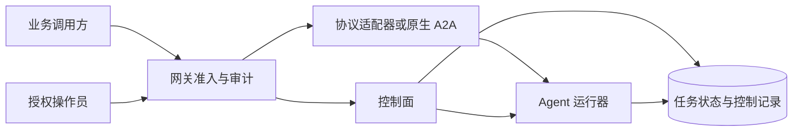

# 第三方 Agent 接入与接管指南

适用于当前 LiteLLM 网关身份集成分支，源码核对基线为 `5ba7202074`。协议字段以各版本官方规范为准。本文给出接入设计、配置和验收方法，示例配置需在目标部署上验证。

## 1. 选择接管能力

先按业务需要声明每个 Agent 的能力。能力可以组合，上线时按实际通过的能力开放操作。

| 能力 | 操作 | 执行方 | 完成证据 |
| --- | --- | --- | --- |
| 代理调用 | 发现 Agent、发送消息、返回结果 | 网关鉴权后转发，Agent 执行 | 网关记录与上游日志可关联 |
| 任务接管 | 查询进度、请求取消、订阅状态 | 上游 Agent 或掌握运行器的适配器 | 任务终态、运行器确认、外部副作用记录 |
| 人工接手 | 暂停在检查点，审批、补充输入、移交或恢复 | Agent 运行器与人工工作台 | 已持久化的检查点、接手人、版本和审计记录 |
| 实例紧急停用 | 关闭准入、停止队列和运行中的任务 | 网关执行准入封禁，上游控制面清理任务 | 网关拒绝新请求，上游确认队列和运行器均已处理 |

会议纪要示例只实现代理调用。要提供任务接管，先让 Octop 适配器保留每次调用的 Octop 线程 ID，再建立可查询的任务映射与取消流程。停止收 SSE、关闭 WebSocket 或返回超时只影响连接；任务状态需要向执行端独立核对。



## 2. 按协议版本接入

| 上游形式 | 接入配置 | 任务控制 |
| --- | --- | --- |
| A2A 0.2.x | 核对具体小版本，旧发现路径通常为 `/.well-known/agent.json`。保留旧端时，用适配器提供可验证的 0.3 JSON-RPC 接口，转换卡片、消息、任务和错误。 | 以实际 0.2.x 实现为准。0.2.6 定义 `tasks/get` 和 `tasks/cancel`；旧服务器的可取消状态仍需实测。 |
| A2A 0.3.x JSON-RPC | 推荐作为当前网关的任务控制上游接口。提供 `/.well-known/agent-card.json` 和卡片声明的 JSON-RPC 地址，按网关实际注册 URL 检查发现路径。 | `message/send`、`message/stream`、`tasks/get`、`tasks/cancel`、`tasks/resubscribe` 按已实现能力开放。启用流式时也要验证断线重连。 |
| A2A 1.0 JSON-RPC | 客户端发送 `A2A-Version: 1.0`，使用 PascalCase 方法及 1.0 负载。卡片用 `supportedInterfaces` 描述绑定。当前网关对外可转换 1.0，但控制转发以 0.3 为内部格式。 | 对只接受 1.0 的上游，为控制方法部署 0.3↔1.0 适配层，双向映射方法、参数、结果、错误和事件。若上游提供已验收的 0.3 兼容接口，可直接使用该接口。 |
| A2A HTTP+JSON 或 gRPC | Agent Card 按版本声明真实绑定；为当前网关的控制路径提供 JSON-RPC 适配层，将 RPC 映射到 REST 或 gRPC 方法。 | 保留鉴权、租户、取消语义和任务终态。能发消息与能取消需要分别验收。 |
| 自定义 HTTP、WebSocket 或队列 Agent | 在适配层暴露 0.3 卡片和 JSON-RPC，内部调用原有 API 或调度器。任务映射必须可持久化。 | 只有运行器能提供状态和停止确认时，才声明支持任务接管。 |
| 仅 OpenAI 兼容聊天 API | 可以用于消息调用，按网关部署支持的模型代理或 A2A 包装接入。 | 聊天响应 ID、客户端断开和 HTTP 超时都不能当作任务控制能力。新增作业接口和取消机制后再开放接管。 |
| MCP 工具服务 | 使用网关 MCP 接入能力发布工具。若要将一组工具操作作为 Agent 任务，增加具备持久状态的运行器。 | 按 MCP 具体版本和工具服务实现验证取消；整个业务任务的接管由运行器负责。 |

版本选择需要同时核对 **客户端到网关** 和 **网关到上游**。当前网关的 `_served_version` 会优先读取卡片中精确匹配的 `0.3` 或 `1.0`，再考虑方法名与版本头。1.0 方法名会映射为旧式方法名，任务控制的转发参数按需转换为 0.3，响应再向客户端转换。网关的消息调用还通过 SDK 发现上游卡片。仅修改卡片版本号或只增加版本头，无法替代上游适配与回归。固定网关提交、SDK 版本、上游版本和绑定，再运行下面的验收矩阵。

参考 [A2A 0.2.6](https://github.com/a2aproject/A2A/blob/v0.2.6/docs/specification.md)、[A2A 0.3.0](https://github.com/a2aproject/A2A/blob/v0.3.0/docs/specification.md)、[A2A 1.0.0](https://github.com/a2aproject/A2A/blob/v1.0.0/docs/specification.md)。

## 3. 在网关登记 Agent 和控制端点

有数据库的网关可由代理管理员用 `POST /v1/agents` 创建，后续通过 `PATCH /v1/agents/{agent_id}` 更新。配置文件部署可将条目放入 `agents`。示例以双向兼容的 0.3 JSON-RPC 适配器为上游，`url` 需要可从网关访问。

```yaml
agents:
  - agent_name: third-party-meeting-notes
    static_headers:
      Authorization: os.environ/AGENT_UPSTREAM_AUTHORIZATION
    agent_card_params:
      protocolVersion: "0.3.0"
      name: 会议纪要整理助手
      description: 提取会议决定与行动项
      url: https://agent.internal.example/a2a
      version: "1.2.0"
      capabilities:
        streaming: false
      defaultInputModes: [text]
      defaultOutputModes: [text]
      skills:
        - id: meeting-notes
          name: 整理会议纪要
          description: 输出决定、行动项和未确认问题
          tags: [meetings]
```

- 入站凭证只在网关使用。网关到 Agent 使用单独的服务凭证。需要用户委托时，在独立流程中为目标 audience 取得经验证的令牌，不将网关入站 token 或调用者自报的身份头直接转交给上游作为授权依据。
- 网关按 Agent 授权。任务服务还要按租户、主体与任务归属检查 `get`、`cancel`、流订阅、列表和产物下载。共享上游服务凭证时，应使用受信任的委托上下文或按租户隔离。只有能验证来源与权限的身份上下文才用于决策。
- 管理接口与执行接口分配不同权限。限制网关出站目标和管理回调域名，生产采用 HTTPS 或受控 mTLS。调用方无法指定后端地址、目标 Agent 运行账号或管理凭证。管理凭证来自部署密钥设施。

### 任务取消与状态核对

通过网关 `POST /a2a/{agent_id}` 发送 JSON-RPC。示例使用已返回的上游任务 ID。HTTP 200 仍可能携带 JSON-RPC `error`，客户端必须检查响应体。

```json
{"jsonrpc":"2.0","id":"cancel-01","method":"tasks/cancel","params":{"id":"task-123"}}
```

```json
{"jsonrpc":"2.0","id":"cancel-02","method":"CancelTask","params":{"id":"task-123"}}
```

第一条面向 0.3。第二条面向已配置和验收的 1.0 客户端入口，同时发送 `A2A-Version: 1.0`。分别用 `tasks/get` 或 `GetTask` 查询同一 ID。只有执行端确认取消终态且资源和副作用核对完成，才能对操作员显示「已停止」。任务已提交外部写入时，应区分已提交、已取消和已补偿。

### 实例级紧急停用

管理员可在该 Agent 的配置中设置 `kill_switch`。示例展示写入管理 API 的片段，密钥占位符必须在部署侧安全替换。

```json
{
  "kill_switch": {
    "url": "https://agent-control.internal.example/v1/agents/meeting-notes/stop",
    "method": "POST",
    "auth": {"type": "bearer", "token": "<独立的控制面凭证>"},
    "body": {"mode": "stop_accepting_and_cancel_running"}
  }
}
```

有 `PROXY_ADMIN` 权限的运维人员调用 `POST /v1/agents/{agent_id}/kill_switch`。当前网关只发送已配置的 HTTP 请求，默认超时为 10 秒且不跟随重定向。上游返回 2xx 时网关报告触发成功，其他结果报告 502。代码会尝试写入 `kill_switch_fired` 审计。该入口不会自动修改网关 Agent 状态，也无法确认上游任务已经停止。

建议停用顺序如下。

1. 在网关撤销该 Agent 的调用授权或应用经过验证的准入封禁规则，确认新调用被拒绝。启用标志在不同注册类型和部署下的实效需要验收。
2. 由管理员触发预先配置的 kill switch。上游控制面立即拒绝新任务，暂停消费队列，对可取消任务发出停止信号，并记录操作 ID。重复触发应返回同一停用结果或等价状态。
3. 操作员按上游控制面查询操作进度和任务终态。超时或 502 表示结果未确认，先查执行端与审计，再以同一操作语义重试。上游返回 202 表示已受理，继续核对实际状态。
4. 恢复采用单独审批的操作，确认积压任务的处理策略、凭证权限和运行器状态后，再恢复网关准入。

## 4. 自定义 Agent 的改造契约

### 持久任务与运行器

为每个可接管动作持久化 `tenant_id`、`owner_id`、`agent_id`、`task_id`、`backend_job_id`、状态、版本、时间戳、输入摘要和审计关联 ID。状态与业务提交边界放在 Agent 服务端。JSON-RPC `id` 用于关联请求响应，幂等键单独管理，并绑定租户、调用者和请求摘要。跨进程重试须读取既有任务记录。

| 上游操作 | 实现要求 |
| --- | --- |
| 提交 | 创建任务与幂等记录，再投递运行器。排队或长任务返回 Task ID。纯同步文本可返回 Message，调用方只能观察该响应。 |
| 查询 | 校验任务归属，返回当前任务状态及已授权产物。内部状态映射到所声明 A2A 版本的 Task 状态。 |
| 取消 | 原子记录取消请求，阻止排队任务启动，通知执行器在安全点停止。由运行器确认终态。不能取消的阶段返回版本对应的不可取消错误。 |
| 人工介入 | 在可恢复检查点保存进度、原因与待确认参数；通过应用使用受授权的审批或接手操作。恢复校验租户、接手人、任务版本和幂等键。 |
| 订阅和重连 | 可选。按版本实现事件序列、当前状态快照和重连语义。去重靠任务与事件标识，最终状态以查询接口为准。 |
| 紧急停用 | 控制入口与业务入口分隔。持久化停止接单状态，关闭工作进程准入，处理已排队与运行中的任务，并提供可查询证据。 |

内部可使用 `queued → running → cancel_requested → canceled` 和 `running → awaiting_review → running` 状态链。成功、失败、取消为互斥终态，并发提交与取消用版本检查或事务决定唯一结果。`cancel_requested` 属于内部过渡态，映射到协议允许的状态，附带可理解的说明。人工介入状态只能映射到协议能表达的语义，完整审批和接手人信息留在受授权的应用控制面。

Octop 扩展示例中，适配器为每个 A2A Task 建立独立 Octop 会话，记录实际 Octop `thread_id`。查询通过持久化状态或 Octop 线程记录对账。取消调用 Octop chat WebSocket 的 `{"type":"cancel","thread_id":"..."}`，并等待 Octop 执行端确认。关联记录、任务所有权、终态对账及工作台审批需在扩展版实现。现有单轮会议纪要示例只提供消息代理。

## 5. 上线验收

每个组合独立记录客户端 A2A 版本、网关提交、SDK 版本、上游版本和绑定、真实 URL 路由、凭证类型、请求 ID、任务 ID，以及网关和执行端的状态证据。控制类测试必须启动可观察的实际任务和工作进程。外部写入可用隔离资源或可逆的测试目标。

| 用例 | 通过标准 |
| --- | --- |
| 发现与每跳版本 | 卡片可读、通告地址可用，鉴权及版本行为符合配置。0.2/1.0 适配路径回放真实标准负载。版本不兼容返回可识别错误。 |
| 调用和响应 | 验证 0.3 和声称支持的 1.0，分别核对方法、消息或任务负载，以及跨版本错误。 |
| 排队取消和运行中取消 | 排队作业未启动。运行中作业在约定时间内停止并返回正确终态，执行器与下游可验证无新增副作用。 |
| 并发与重试 | 重复提交命中同一任务。重复取消没有重复副作用。取消与完成竞态产生唯一终态。验证网关超时后任务仍可查询。 |
| 人工接手 | 检查点可恢复，只有有权人员能接受或拒绝。并发审批中的旧版本被拒绝。恢复不会重复提交外部写入。 |
| 权限隔离 | 无凭证、无 Agent 权限、跨租户任务 ID 和普通调用者触发 kill switch 均被拒绝。 |
| 断流与重启 | 断流不被误判为取消；重连后可查询真实状态。重启时任务映射及停止接单状态仍有效。 |
| 紧急停用及恢复 | 验证网关封禁、上游停收、清理作业、审计与故障重试。模拟 502 和上游 202，确认界面不会提前显示已停止。 |

当前实现可参阅 [A2A 路由](../litellm/proxy/agent_endpoints/a2a_endpoints.py)、[版本转换](../litellm/proxy/a2a/version_convert.py)、[Agent 管理入口](../litellm/proxy/agent_endpoints/endpoints.py) 和 [kill switch 实现](../litellm/proxy/agent_endpoints/kill_switch.py)。
