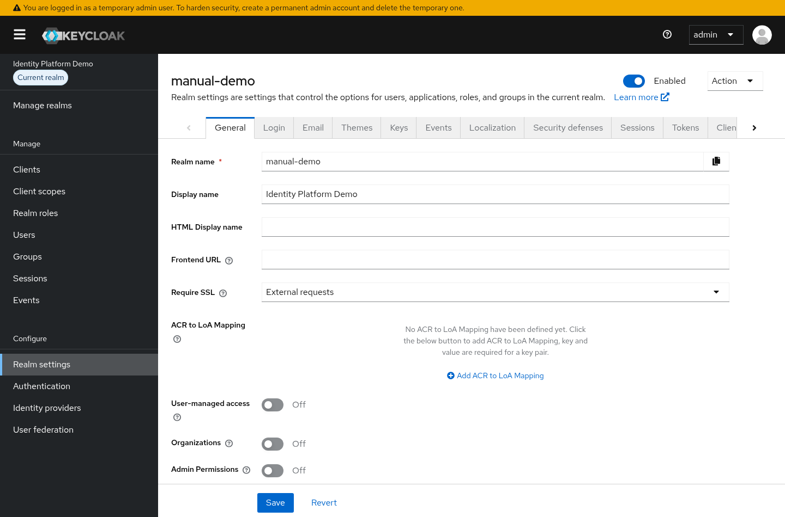
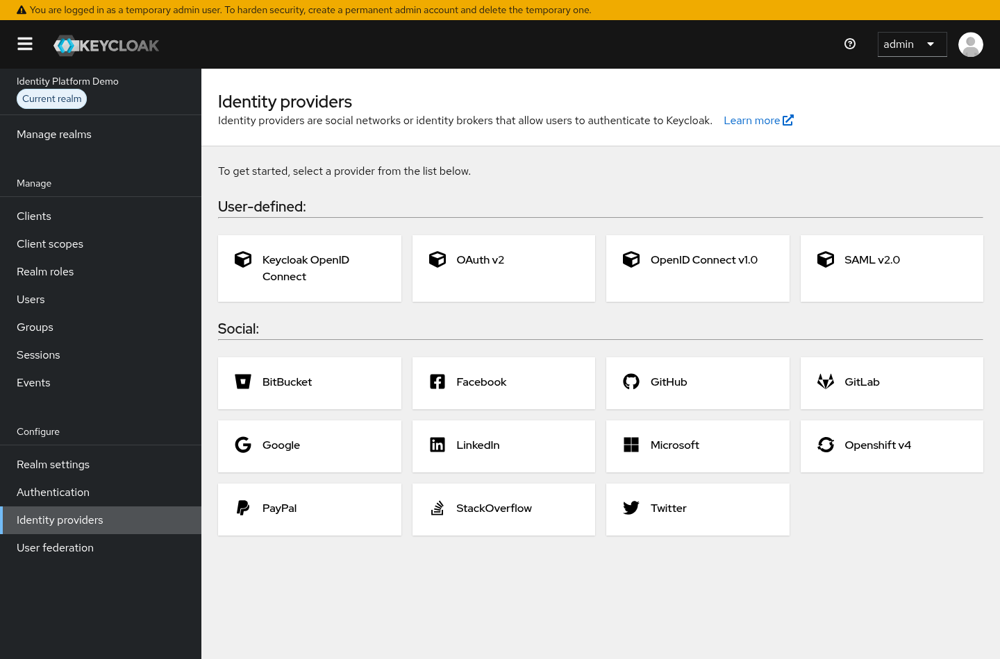
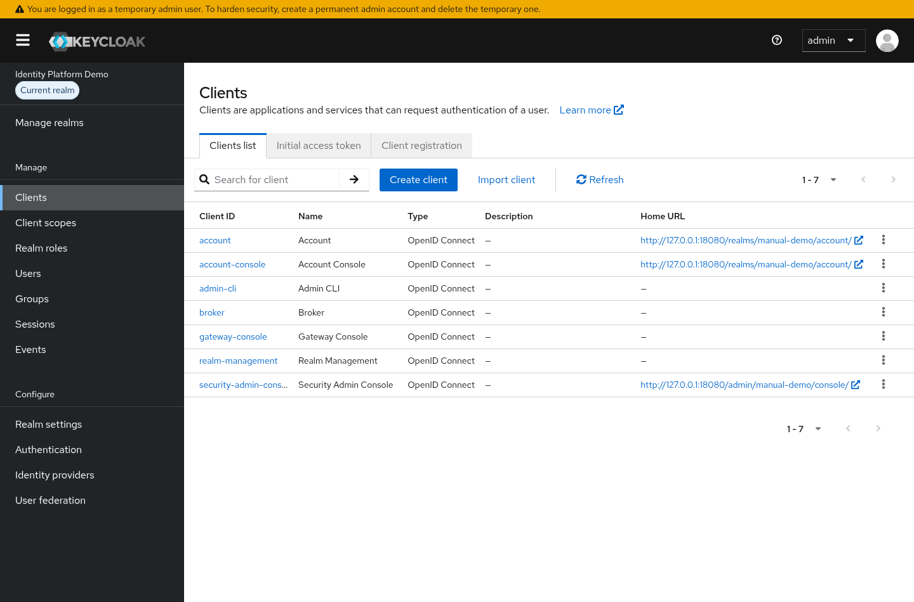
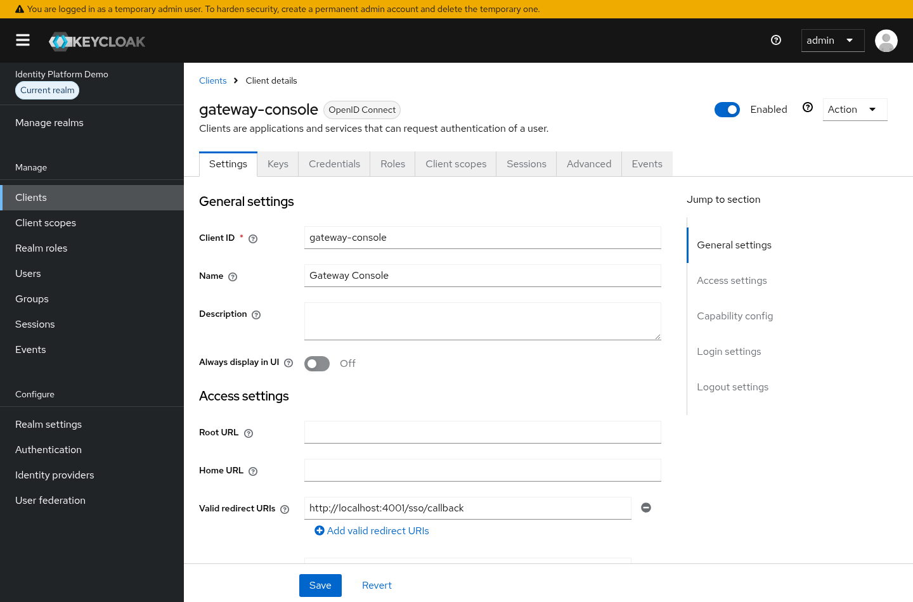
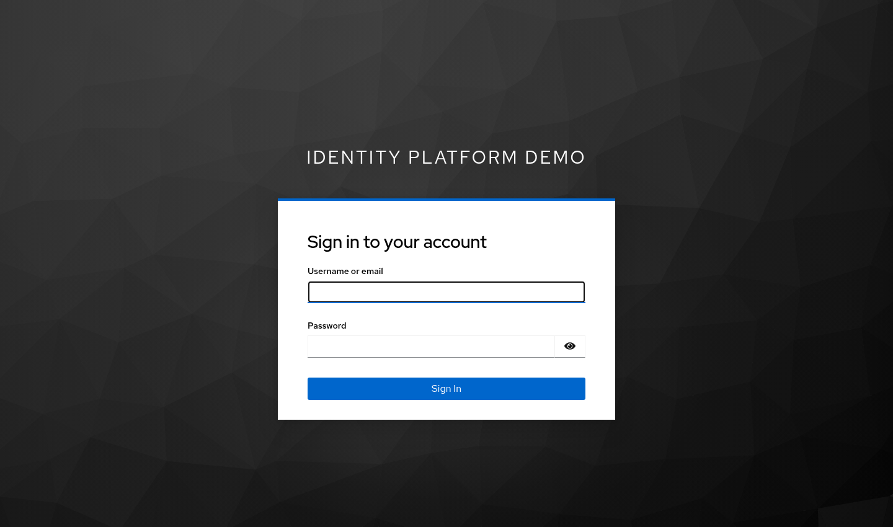
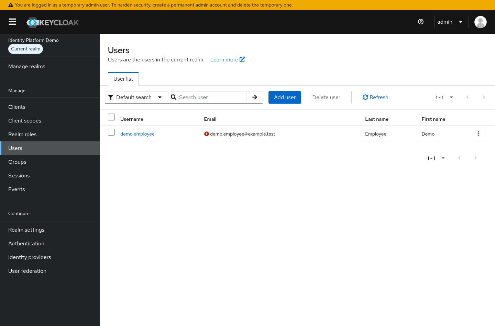
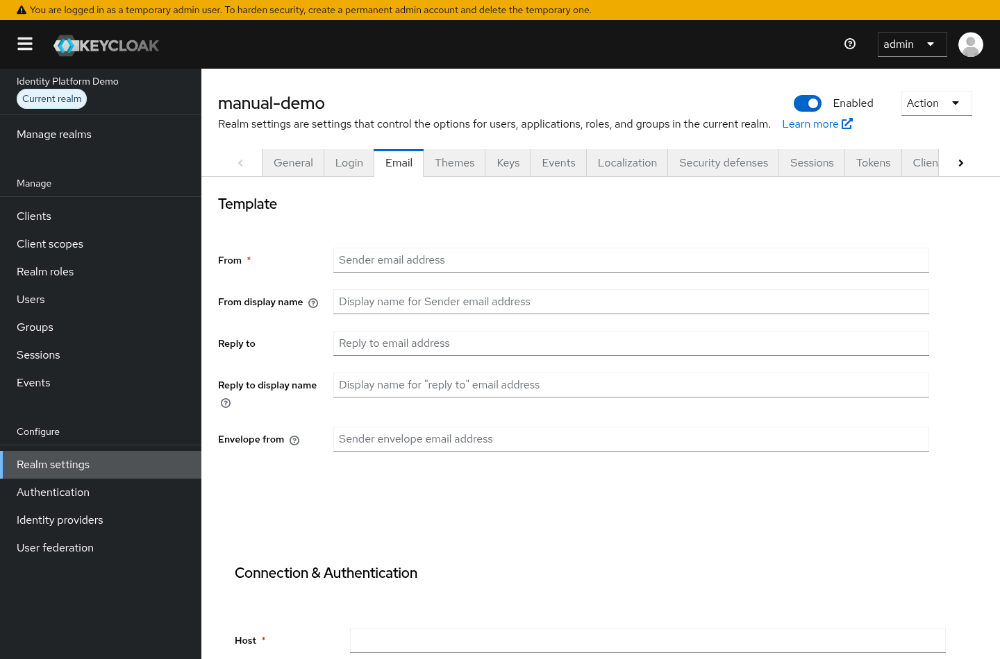
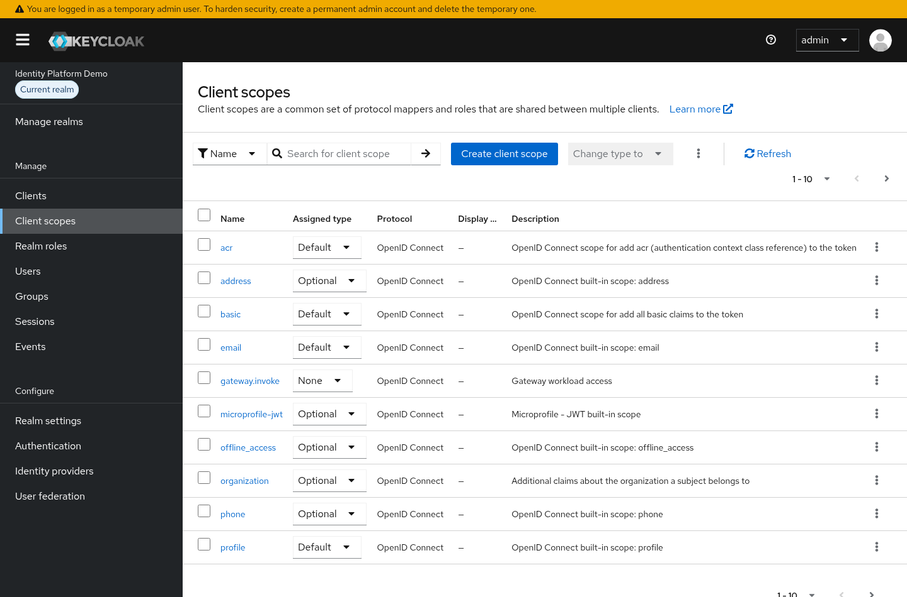

# 身份平台与认证模块配置使用手册

本手册覆盖 LiteLLM 网关接入身份平台的完整配置和操作流程，面向网关管理员、身份平台管理员和 Agent 运维人员。内容基于当前分支 `litellm_identity_platform_integration` 的代码（HEAD `0bea702903`）。

## 0. 阅读前须知

平台当前是可独立启动的开发与集成环境，不是已完成生产验收的统一身份产品。下表列出实际可用的能力和仍需部署方自行验收的部分，配置时应按此边界安排上线计划。

| 能力 | 当前状态 | 说明 |
| --- | --- | --- |
| Keycloak realm、用户与应用管理 | 可用 | 26.4.7 镜像，PostgreSQL 16 持久卷 |
| Generic SSO 授权码登录与 S256 PKCE | 组件级已验证 | 真实 Keycloak 加真实浏览器，回调被测试拦截 |
| 统一 OIDC 严格准入 | 组件级已验证 | 验签、nonce、预绑定准入门禁 |
| 员工预批准绑定 | 组件级已验证 | 目录只读客户端加权威主体校验 |
| 访客开户与激活状态机 | 组件级已验证 | 状态由身份记录与网关绑定推导 |
| Agent 注册、凭证一次性领取、停用 | 已验证 | 真实 Keycloak 与实际 CLI，网关 HTTP 使用替身 |
| 网关侧管理控制台外链入口 | 可用 | Settings 下按管理员角色显示 |
| 真实网关数据库写入与控制台会话 | 未验收 | Prisma 引擎校验文件下载返回 403 |
| 真实 SMTP 投递与企业上游 IdP | 未验收 | 需要部署方环境实测 |
| 统一管理 API、事件同步、SDK、DPoP | 未实现 | 属于目标态设计 |

本手册中的截图来自隔离演示 realm `manual-demo`，开发部署默认业务 realm 为 `company`。截图展示的位置和字段在两种 realm 中一致，示例账号与域名不可直接用于生产。

## 1. 启动身份平台

在仓库根目录进入 `identity-platform`，准备本地环境文件。

```bash
cd identity-platform
cp .env.example .env
```

编辑 `.env`，为 `IDENTITY_DB_PASSWORD` 和 `IDENTITY_ADMIN_PASSWORD` 设置两个不同且足够强度的密码。`IDENTITY_ADMIN_USER` 默认为 `admin`。引导管理员只用于初始配置，产品集成应使用独立管理客户端。

启动并确认容器状态。

```bash
docker compose up -d
docker compose ps
```

Compose 固定使用带 digest 的 Keycloak 26.4.7 和 PostgreSQL 16，管理台只绑定 `127.0.0.1:18080`，数据保存在命名卷 `identity-db`。停止服务使用 `docker compose down`，不要加 `-v`，否则会删除身份数据库卷。

访问 `http://127.0.0.1:18080/admin/`，用引导管理员登录，在左上角切换到业务 realm `company`。进入 Realm settings 确认 realm 名称与启用状态，如图 1 所示。生产部署应使用所有使用方都能访问的 HTTPS 地址，关闭 `start-dev`，并配置独立管理客户端、备份和访问限制。



图 1 要点，`manual-demo` 是演示 realm，生产对应 `company`。页面顶部有临时管理员提示，生产环境应创建永久管理员并删除临时账号。Discovery 端点为 `http://127.0.0.1:18080/realms/company/.well-known/openid-configuration`，在该 URL 后追加路径即可查看全部 OIDC 端点。开发模式下 `/health/ready` 返回 404，就绪检查用 `GET /realms/company` 是否返回 200 代替。

## 2. 接入企业登录

在业务 realm 左侧 **Manage** 区域打开 **Identity providers**，如图 2 所示，添加 OpenID Connect 提供方。



图 2 要点，填写企业 IdP 的 discovery URL，以及 Keycloak 作为客户端获得分配的 Client ID 和客户端密钥。页面会显示一个 **Redirect URI**，必须原样登记到企业 IdP 的客户端白名单。用一名测试员工完成上游登录，然后在 **Users** 中确认已出现或已关联预期的 realm 用户，后续网关绑定使用该 realm 用户 ID。

已有员工账号的关联遵循企业自身流程。通讯录同步能力目前仍属于规划，管理员当前可通过已配置的企业 IdP、受控导入或 realm 用户管理提供员工身份。企业微信自建应用扫码登录通过可选 Keycloak 插件接入，详见 [企业微信身份提供方](WECOM.md)。它不是通用 OIDC 提供方，不能直接填写到 OIDC discovery URL 中，也不提供通讯录同步。

## 3. 配置网关 SSO 与统一 OIDC

### 3.1 准备登录客户端

首次导入的 `company` realm 包含两个客户端。`gateway-console` 是 confidential 登录客户端，使用标准授权码流程，必须启用 S256 PKCE，回调地址当前示例为 `http://127.0.0.1:4001/sso/callback`。`ai-governance-gateway` 是 `bearerOnly` 资源客户端，只作为 access token 的 audience。

在 **Clients** 中查看客户端列表，如图 3 所示。



打开 `gateway-console` 的 **Settings**，检查授权码流程和 PKCE 设置，并把产品实际提供的回调地址登记到 **Valid redirect URIs**，如图 4 所示。



图 4 要点，回调地址必须与网关环境变量 `PROXY_BASE_URL` 逐字一致。仓库中存在 `4000` 与 `4001` 两种示例，照抄而不核对会导致 SSO 回调跳回 IdP。当前 `gateway-sso.env.example` 和 `realm.json` 使用 `http://127.0.0.1:4001/sso/callback`，而部分集成文档示例使用 `4000`。部署时以实际网关监听地址和客户端配置为准，两端必须完全一致。

`gateway-console` 初始没有预置 secret。首次启动后需要在管理台生成或轮换，并通过部署密钥设施注入网关环境，不要提交到仓库。

### 3.2 网关 Generic SSO 变量

以 `identity-platform/gateway-sso.env.example` 为基础配置网关核心环境。关键变量如下。

| 变量 | 用途 |
| --- | --- |
| `GENERIC_CLIENT_ID` / `GENERIC_CLIENT_SECRET` | `gateway-console` 客户端凭证 |
| `GENERIC_AUTHORIZATION_ENDPOINT` | Keycloak 授权端点 |
| `GENERIC_TOKEN_ENDPOINT` | 授权码换 token 端点 |
| `GENERIC_USERINFO_ENDPOINT` | userinfo 端点 |
| `GENERIC_CLIENT_USE_PKCE=true` | 启用 S256 PKCE |
| `PKCE_STRICT_CACHE_MISS=true` | 缺少 state 或 verifier 时直接拒绝回调 |
| `GENERIC_USER_ID_ATTRIBUTE=sub` | 使用稳定 `sub`，避免可变用户名 |
| `PROXY_BASE_URL` | 必须与 Keycloak 回调地址逐字一致 |

只选择 Generic SSO 一个提供商，避免同时启用 Microsoft 或 Google 配置导致旧选择逻辑优先匹配其他提供商。

### 3.3 统一 OIDC 严格准入

在通用 SSO 基础上额外设置以下变量，启用统一 OIDC 模式。

```dotenv
LITELLM_UNIFIED_OIDC_ISSUER=https://identity.example.internal/realms/company
LITELLM_UNIFIED_OIDC_JWKS_URL=https://identity.example.internal/realms/company/protocol/openid-connect/certs
GENERIC_CLIENT_USE_PKCE=true
PKCE_STRICT_CACHE_MISS=true
```

授权端点、令牌端点和 JWKS 端点必须与 issuer 位于同一信任域。登录入口会向授权 URL 注入 nonce，回调时校验 ID Token 签名、issuer、audience、有效期、nonce 和授权方，多 audience 时还校验 `azp`。ID Token 中的 `role` 不会被继承为网关角色。

准入门禁要求 `(issuer, subject)` 绑定已预先批准。该绑定以 `oidc:v1:sha256(json([issuer, subject]))` 形式保存在网关 `sso_user_id`，停用账号会被拒绝。上线前应先绑定并测试至少一个运维管理员账号，再开启严格模式。关闭上述两个 `LITELLM_UNIFIED_OIDC_*` 变量即可回退到旧 SSO 匹配策略。

用户从产品登录页发起 SSO 后跳转到 Keycloak。配置企业 IdP 时会出现企业登录入口，演示 realm 的本地登录页如图 5 所示。



图 5 要点，这是 `manual-demo` 的本地账号登录页，仅用于演示。生产环境中应使用企业 IdP 联邦登录，登录成功后返回产品的 `/sso/callback`。缺少 state、state 不匹配和回调重放都会被拒绝。

## 4. 配置 JWT 验证

网关需要启用已有 JWT 功能并配置受信任 issuer、audience 和 JWKS。配置写在 `general_settings.litellm_jwtauth` 下，不能写在顶层。

关键字段包括 `enable_jwt_auth`、`strict_issuer_allowlist`、`issuers[].issuer`、`issuers[].jwks_url`、`issuers[].audience`。用户映射使用 `user_id_jwt_field: sub` 和 `user_email_jwt_field: email`，`user_id_upsert` 保持 `false`，角色映射使用 `roles_jwt_field: realm_access.roles` 配合 `role_mappings` 和 `enforce_rbac`。

Keycloak 侧需要把 audience `ai-governance-gateway` 写入 access token，通过 audience mapper 实现。`realm.json` 声明了 `gateway-user` 和 `gateway-agent` 两个 realm role，但当前代码不自动读取，必须通过 `role_mappings` 显式配置。

`issuers` 列表不是严格白名单，未命中的 issuer 会回退到全局 `JWT_ISSUER` 和 `JWT_AUDIENCE`。生产环境应避免全局双空配置，并确认 `strict_issuer_allowlist` 生效。签名合法只代表认证通过，模型、工具和预算权限仍由网关本地授权配置决定。

## 5. 关联员工账号

### 5.1 从网关页面关联

网关管理员在「用户 → 邀请用户」中可以看到「关联已有员工」模式，前提是该能力开关已开启。开关由后端 `/sso/get/ui_settings` 返回，仅 PROXY_ADMIN 可见。

在 Keycloak 的 **Users** 中按用户名搜索，进入用户详情复制 realm 用户 ID，如图 6 所示。



图 6 要点，需要复制的是 realm 用户 ID，不是用户名或邮箱。该 ID 作为精确主体写入绑定。对于首次登录才会产生本地主体的上游用户，应先按第 2 节完成企业 IdP 关联，再执行绑定。

网关侧需要配置只读目录客户端。

```dotenv
LITELLM_IDENTITY_DIRECTORY_CLIENT_ID=<client-id>
LITELLM_IDENTITY_DIRECTORY_CLIENT_SECRET=<client-secret>
```

使用业务 realm 中独立的 confidential service account，仅授予读取目标 realm 用户的权限，例如 `realm-management/view-users`。该客户端与控制台登录客户端及 Agent 工作负载客户端分开，密钥只注入网关核心环境。

管理员填写 realm 用户 ID 后，前端调用 `POST /sso/users/link`，请求体为 `{"subject": "<realm-user-id>"}`。后端要求 PROXY_ADMIN 角色，通过 Keycloak Admin API 确认用户存在、启用、非服务账号且 ID 精确匹配，然后按 `(issuer, sub)` 摘要核对或创建网关账号。新账号没有默认模型权限和 API Key，后续由网关管理员审批分配。重复提交或并发创建由数据库唯一约束收敛。

### 5.2 使用命令行预批准

也可以用仓库脚本完成同样的绑定。

```bash
export IDENTITY_USER_MANAGER_TOKEN=<keycloak-read-token>
export IDENTITY_GATEWAY_PROVISIONING_TOKEN=<gateway-admin-token>
PYTHONPATH=. python identity-platform/user_onboard.py \
  --issuer https://identity.example.internal/realms/company \
  --gateway https://gateway.example.internal \
  <Keycloak-realm-user-id>
```

工具会拒绝停用账号和服务账号，重复运行返回同一绑定。发现冲突时应人工核对，不要用邮箱猜测主体。

## 6. 邀请访客

### 6.1 身份平台前置配置

在 **Realm settings → Email** 配置 SMTP，如图 7 所示。



图 7 要点，需要配置 SMTP 主机、端口、认证账号和发件地址。邮件发送响应只代表 Keycloak 接受请求，不代表已送达。首次启用前应使用测试邮箱完成激活回归。

同时完成以下 realm 配置。

- 关闭重复邮箱。
- 关闭邮箱即用户名和用户自助注册。
- 禁止用户自行修改用户名。
- 预留 `litellm-guest-` 用户名前缀，禁止外部联邦按邮箱自动关联本地访客。
- 在 Realm settings → User profile 中新增 `litellm_guest_operation` 属性，仅允许管理员查看和编辑。

网关侧需要独立的访客管理服务账号。

```dotenv
LITELLM_IDENTITY_GUEST_CLIENT_ID=<client-id>
LITELLM_IDENTITY_GUEST_CLIENT_SECRET=<client-secret>
```

该 service account 的权限限定在业务 realm 的用户创建、读取与执行激活动作，与员工目录只读客户端分开。

### 6.2 操作流程

在网关中选择「用户 → 邀请用户 → 邀请访客」，填写外部邮箱，然后按以下顺序操作。

1. 点击「准备访客账号」。后台创建无密码且待验证的 Keycloak 用户，并写入 `litellm_guest_operation` 操作标记，然后创建最低权限网关绑定。
2. 点击「查询状态」确认当前阶段。相同 realm 和规范化邮箱对应同一操作，重复准备只补齐缺失的绑定。
3. 状态为「网关账号已关联，访客待激活」时点击「发送激活邮件」。Keycloak 发送一小时有效的操作链接，要求验证邮箱并设置密码。

前端调用 `POST /sso/users/guest`，请求体为 `{"email": "<address>", "action": "prepare|status|send"}`。后端要求 PROXY_ADMIN 角色，返回 `operation_id` 和状态。状态取值包括 `not_started`、`identity_created`、`awaiting_activation`、`activation_requested` 和 `active`。

发送超时后应先查询状态，再核对身份平台或 SMTP 日志，不要立即重发。发现与企业身份冲突时改用员工关联流程或人工核对。

## 7. 注册 Agent 工作负载

### 7.1 创建调用 scope

在 **Client scopes** 中创建名为 `gateway.invoke` 的 scope，并启用 **Include in token scope**，如图 8 所示。



图 8 要点，初始 `realm.json` 导入不包含 `gateway.invoke`，这是部署前必须手动补做的前置步骤。注册服务会检查该 scope 存在且 `include.in.token.scope=true`，否则返回 503。scope 按工作负载单独授予，不要授予登录客户端。

### 7.2 部署注册服务

在 `identity-platform` 目录安装依赖并启动独立进程。

```sh
python -m pip install -r requirements-agent-admin.txt
python -m uvicorn agent_registration:app --host 127.0.0.1 --port 18081
```

生产环境使用 `deploy/identity-agent-registration.service`，以单 worker 运行并监听 `127.0.0.1:18081`，由 TLS 反向代理对外暴露。真实环境文件放在 `/etc/identity-agent-registration.env`，由 root 持有并设置 `0600`。状态保存在 SQLite 文件，systemd 使用 `StateDirectory=identity-agent-registration`，路径为 `/var/lib/identity-agent-registration/registrations.sqlite3`。

| 环境变量 | 用途 |
| --- | --- |
| `AGENT_ADMIN_ISSUER` | Keycloak realm issuer，同时作为网关绑定的 `tenant_id` |
| `AGENT_ADMIN_JWKS_URL` | 校验操作员 JWT 的 JWKS 端点 |
| `AGENT_ADMIN_AUDIENCE` | 注册 API 的 audience，示例 `identity-agent-registration` |
| `AGENT_ADMIN_OPERATOR_CLIENT_ID` | 操作员令牌 `azp`，示例 `agent-registration-operators` |
| `AGENT_ADMIN_KEYCLOAK_CLIENT_ID` / `AGENT_ADMIN_KEYCLOAK_CLIENT_SECRET` | 服务端管理客户端，需要 `manage-clients` 和 `view-users` |
| `AGENT_ADMIN_GATEWAY_URL` / `AGENT_ADMIN_GATEWAY_TOKEN` | 网关地址和能查询、创建、停用 Agent 的管理凭证 |
| `AGENT_ADMIN_GATEWAY_AUDIENCE` | 工作负载令牌 audience，示例 `ai-governance-gateway` |
| `AGENT_ADMIN_DB` | SQLite 文件绝对路径 |

操作员客户端使用授权码加 PKCE，限制已获授权的企业人员访问。通过审批策略授予操作员 Access Token `agent.register` scope，普通用户客户端和工作负载客户端都不授予。注册 API 只接受配置好的签名、issuer、audience 和客户端，并要求 `identity_kind` 不为 `workload`。

### 7.3 注册、领取与停用

将短期操作员令牌注入 `AGENTCTL_OPERATOR_TOKEN`。每次新注册生成一个 UUID，整个操作使用同一个 UUID。以下命令在 `identity-platform` 目录执行。

```sh
export AGENTCTL_OPERATOR_TOKEN=<operator-jwt>
platform=https://identity-admin.example.internal
operation_id=$(python -c 'import uuid; print(uuid.uuid4())')
python agentctl.py --platform "$platform" register "$operation_id" --name octop-worker
python agentctl.py --platform "$platform" status "$operation_id"
python agentctl.py --platform "$platform" credential "$operation_id" --secret-file ./octop-credential.json
python agentctl.py --platform "$platform" disable "$operation_id"
```

`--platform` 只接受 HTTPS，或 localhost、127.0.0.1 和 ::1 的 HTTP。注册状态依次为 `pending`、`identity_created`、`gateway_bound`、`active`，停用依次为 `disabling`、`disabled`。注册响应失败后先查状态，再用同一 UUID 和名称重试。同一操作员下名称不可复用。

凭证只交付一次，重复领取返回 409。`agentctl` 以 `O_EXCL` 和 `0600` 创建新文件，领取成功后通过密钥设施交给运行时。已标记领取但文件丢失时，只能停用并重新注册。凭证文件包含 Keycloak client secret，不要提交到仓库或打印到日志。

Agent 使用文件中的客户端凭证向 issuer 的 token endpoint 申请访问令牌。

```sh
curl -X POST "$token_endpoint" \
  -d grant_type=client_credentials \
  -d scope=gateway.invoke \
  -d client_id="$client_id" \
  -d client_secret="$client_secret"
```

随后以 `Authorization: Bearer <access_token>` 调用网关。网关侧绑定由注册服务通过 `POST /v1/agents` 写入，结构如下。

```json
{
  "agent_name": "contract-agent",
  "execution_mode": "autonomous",
  "identity": {
    "provider": "external_oidc",
    "tenant_id": "https://identity.example.internal/realms/company",
    "client_id": "contract-agent-client",
    "service_principal_id": "实际服务账号的-sub",
    "required_scopes": ["gateway.invoke"]
  }
}
```

`tenant_id` 是精确 issuer，`service_principal_id` 是服务账号 `sub`。`required_roles` 不支持，必须使用 `required_scopes`。外部受管 Agent 目前只支持 `autonomous`，`delegated` 和 `both` 会被明确拒绝。用户可编辑属性不能作为工作负载证明。

停用先禁用网关绑定，再关闭 Keycloak 客户端。若第二步失败，状态为 `disabling`，使用原 UUID 重试。已签发 JWT 在有效期内不会自动撤销，需要配合短令牌有效期和网关绑定禁用。

### 7.4 验收脚本

在隔离环境中启动注册服务、Keycloak 和使用独立数据库的网关，然后运行。

```sh
python identity-platform/smoke_agentctl.py \
  --platform http://127.0.0.1:18081 \
  --gateway http://127.0.0.1:4000 \
  --issuer http://127.0.0.1:18080/realms/company
```

脚本先检查网关 `/health/readiness` 的数据库状态、管理员可见的受信任 issuer 和 Keycloak discovery。加 `--preflight-only` 只做前置检查，不需要 `--platform` 或操作员令牌，但仍需 `OCTOP_E2E_GATEWAY_ADMIN_KEY`。

完整验收覆盖重复注册幂等、凭证文件权限、重复领取拒绝、使用真实令牌调用网关、绑定主体与 `last_authenticated_at` 记录，以及停用后同一 JWT 被拒绝和 Keycloak 拒绝新令牌。

## 8. 第三方 Agent 接管与紧急停用

第三方 Agent 登记通过 `POST /v1/agents` 创建，通过 `PATCH /v1/agents/{agent_id}` 更新。配置文件中 `url` 必须是网关可访问的地址，上游凭证通过 `os.environ/AGENT_UPSTREAM_AUTHORIZATION` 注入。

调用通过 `POST /a2a/{agent_id}` 发送 JSON-RPC。0.3 使用 `tasks/cancel`，1.0 使用 `CancelTask` 并带 `A2A-Version: 1.0` 头，随后用 `tasks/get` 或 `GetTask` 核对终态。HTTP 200 也可能携带 JSON-RPC `error`，必须检查响应体，不能只看状态码。

紧急停用由 PROXY_ADMIN 调用 `POST /v1/agents/{agent_id}/kill_switch`。配置中的 `kill_switch` 描述上游的 URL、方法、认证和请求体。该端点默认 10 秒超时，不跟随重定向，2xx 表示已受理，其他状态返回 502。它不会修改网关 Agent 状态，也不确认上游已停止。推荐顺序是撤销准入、触发 kill switch、核对任务终态，然后单独审批恢复。界面不应在收到 202 时显示「已停止」。

停止 SSE、关闭 WebSocket 或 HTTP 超时只影响连接，不代表任务终止。控制类验收必须启动真实可观察任务和工作进程，外部写入使用隔离且可逆的目标。

## 9. 管理控制台入口

网关管理 UI 在 Settings 分组下显示两个外链入口。后端 `/sso/get/ui_settings` 只在调用者为 PROXY_ADMIN 时返回以下两个 URL。

```dotenv
LITELLM_UI_IDENTITY_ADMIN_URL=https://identity.example.internal/admin/
LITELLM_UI_PROMETHEUS_URL=https://monitor.example.internal/query
```

URL 不允许包含用户名、密码、query 和 fragment，未配置时对应入口隐藏。前端还要求用户角色为 proxy admin 且非只读，因此 `admin_viewer` 加 `isViewOnly` 不会看到入口。入口在 Settings 展开后可见，文案为「身份平台」和「Prometheus」，点击在新标签页打开。

这两个入口不受企业版功能开关控制，但仍受 Settings 分组的角色限制。生产 compose 的 `env.example` 与 `docker-compose.prod.yml` 对 `UI_PASSWORD` 的默认值不同，部署时应显式设置统一值。

## 10. 生产与离线部署

生产 Compose 包含 `core`、`db`、`monitor` 和 `ui` 四个服务。对外入口是 `ui`，默认映射宿主机 `${CORE_PORT:-4000}` 到容器 3000。`core` 只在容器内暴露 4000，由 Nginx 反向代理。Prometheus 默认映射 `${MONITOR_PORT:-9090}`。`PYTHON_IMAGE` 和 `UI_IMAGE` 为必填，未设置时部署会报错。

离线发布使用 `deploy/offline-release/compose.yaml`，所有镜像 `pull_policy: never`，服务处于 `internal: true` 的隔离网络，默认 `BIND_ADDRESS=127.0.0.1`，网关端口默认 `4400`，与生产 compose 的 `4000` 不同。离线环境需要 `LITELLM_TELEMETRY_DISABLED=true`、`LITELLM_OFFLINE_MODE=true` 和 `LITELLM_LOCAL_MODEL_COST_MAP=true`。

拆分镜像构建产物命名遵循固定产品标签，构建时使用 `docker/split/build.sh native|gateway|ui` 并提供 `IMAGE_TAG`。原生扩展随 Python 镜像绑定，Rust 代码变更后需要重新组装 Python 镜像，不要混用不同架构或 Python ABI 的产物。

## 11. 验证记录与已知限制

2026-11-24 在当前分支 HEAD `0bea702903` 本地执行了以下定向验证。

| 验证对象 | 命令 | 结果 |
| --- | --- | --- |
| 后端统一 OIDC 与员工、访客注册 | `pytest tests/unit/proxy/management_endpoints/test_ui_sso.py -k 'unified_oidc or link_employee or directory_enrollment or employee_account_creation or guest_onboarding'` | 21 通过 |
| 邀请用户弹窗三种模式 | `vitest run --project integration src/components/CreateUserButton.integration.test.tsx` | 6 通过 |
| 语言资源 | `vitest run --project unit src/i18n/locales.test.ts` | 4 通过 |
| 管理控制台外链入口 | `vitest run --project component src/components/leftnav.test.tsx -t "management consoles"` | 2 通过 |

侧边栏组件测试全量运行有 17 项失败，均为既有分支定制文案与上游测试期望不一致，例如测试查找 `/litellm home/i` 而实际渲染为 `AI-GovernanceGw`。本次提交新增的两项控制台入口测试均通过，这些失败与身份平台改动无关。

`identity-platform/VALIDATION.md` 记录了更早的组件级和隔离环境验证。需要在预发布环境补做的事项包括：生成 Prisma 客户端后重跑 4 项被阻挡的 SSO 测试，使用真实网关数据库验证 SSO 会话和员工绑定，使用测试邮箱验证访客激活，运行 `smoke_agentctl.py` 验证真实网关绑定和停用，验证 systemd 单元启动，以及确认原有认证方式仍可登录。

以下是配置时需要注意的限制。

- 统一管理能力未实现，`DESIGN.md` 中的 `/api/v1`、Outbox 同步、SDK 和 DPoP 属于目标态。
- 浏览器回调测试多由 Playwright 拦截后直接调用网关组件，未覆盖最终控制台会话签发。
- 拆分镜像仅通过 Compose 配置解析和 shell 语法校验，基础镜像拉取受限，尚未完成构建与运行验收。
- 生产环境必须使用一致且可达的 HTTPS issuer，不能跨容器误用 `127.0.0.1`。
- 注册服务的自动凭证轮换、终端交互式登录和统一审计接入尚未实现。

## 12. 故障排查

| 现象 | 核对项目 |
| --- | --- |
| SSO 跳转报错 | 检查 issuer、客户端回调 URL、PKCE 配置和浏览器会话，`PROXY_BASE_URL` 与 Keycloak 回调是否逐字一致。 |
| 上游认证成功但无法进入产品 | 检查产品是否已关联该 realm 用户 ID，用户是否启用，角色是否已分配。 |
| 统一 OIDC 拒绝已存在用户 | 检查绑定是否为精确 `(issuer, sub)`，账号 `scim_active` 是否为 false，是否存在裸 `sub` 旧绑定。 |
| 访客未收到邮件 | 查询状态，确认已到 `awaiting_activation`，再查 Keycloak 和 SMTP 日志。发送响应不代表送达。 |
| 注册服务返回 503 | 检查 `gateway.invoke` scope 是否存在且包含于 token scope，检查 Keycloak 管理客户端权限和网关凭证。 |
| Agent 能取令牌但网关拒绝 | 检查网关是否信任 issuer、audience 是否匹配、是否包含 `gateway.invoke`、绑定是否启用。 |
| 凭证重复领取返回 409 | 查询 `credential_claimed`。已领取且凭证遗失时，停用并重新注册。 |
| 停用后状态停留在 `disabling` | 使用原操作编号重试并检查网关绑定是否已禁用，再检查 Keycloak 客户端状态。 |
| kill switch 显示已受理但任务仍在运行 | 202 不代表完成，需通过任务查询接口核对终态。 |

## 附录 A 截图索引

| 截图 | 对应配置步骤 |
| --- | --- |
| `screenshots/01-realm-settings.png` | 第 1 节，业务 realm 设置 |
| `screenshots/02-identity-providers.png` | 第 2 节，企业 IdP 联邦入口 |
| `screenshots/03-users.png` | 第 5 节，查找 realm 用户 ID |
| `screenshots/04-clients.png` | 第 3 节，OIDC 客户端列表 |
| `screenshots/05-client-scopes.png` | 第 7 节，`gateway.invoke` scope |
| `screenshots/06-sign-in.png` | 第 3 节，用户登录页 |
| `screenshots/07-smtp.png` | 第 6 节，访客激活邮件 |
| `screenshots/08-client-settings.png` | 第 3 节，客户端回调地址 |

## 附录 B 相关文档

- `README.md` 平台入口与验收命令
- `USER_MANUAL.md` 面向管理员的配图操作手册
- `GATEWAY_INTEGRATION.md` 网关接入步骤与验收边界
- `INTEGRATION.md` 对接原理与配置字段
- `VALIDATION.md` 验证记录与未验收项
- `DESIGN.md` 目标态设计规格
- `SOLUTION.md` 整体方案与能力状态
- `../docs/THIRD_PARTY_AGENT_TAKEOVER.md` 第三方 Agent 接管指南
