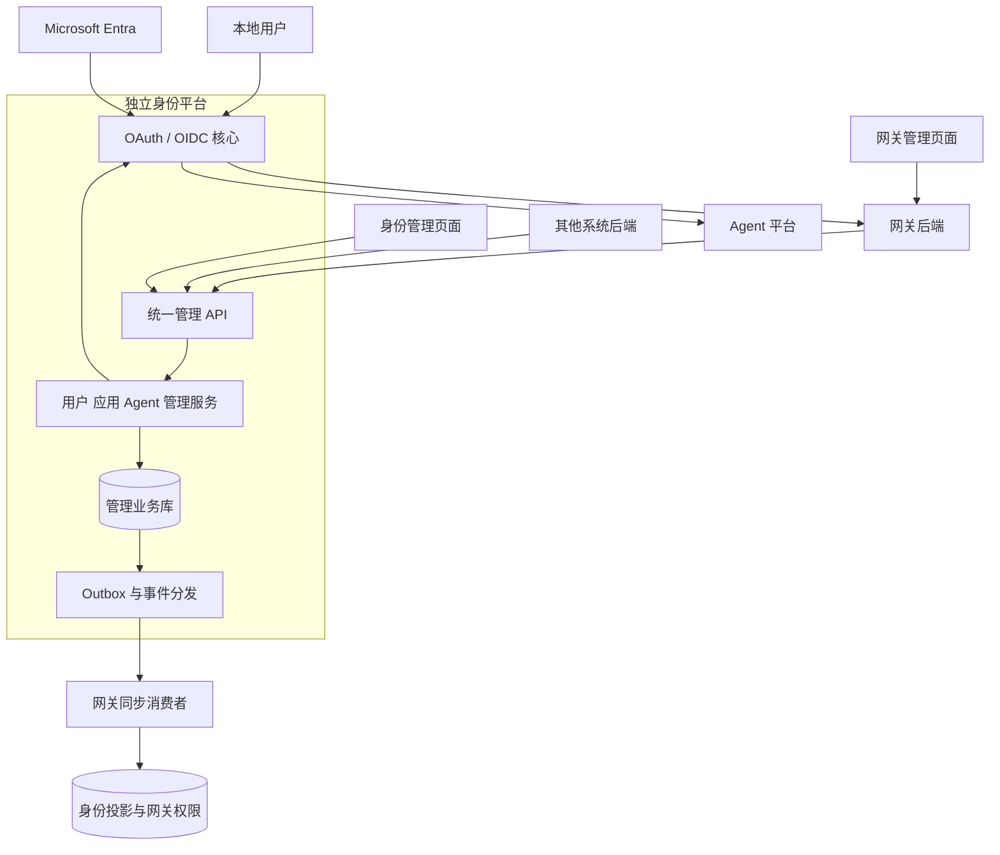
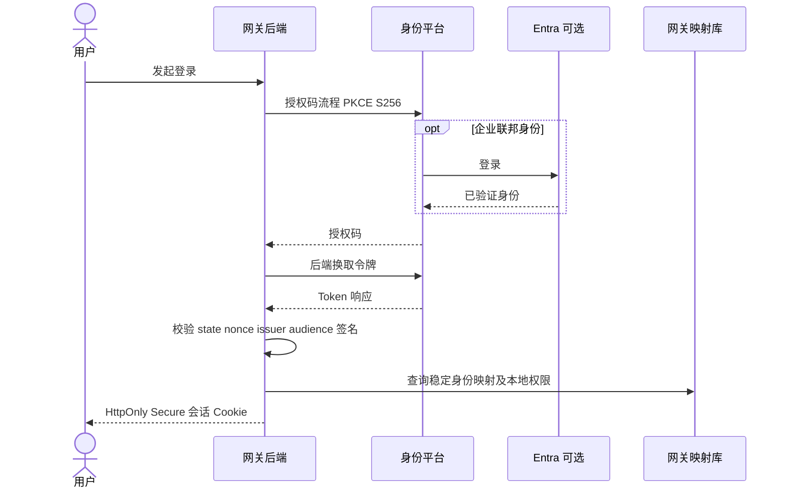
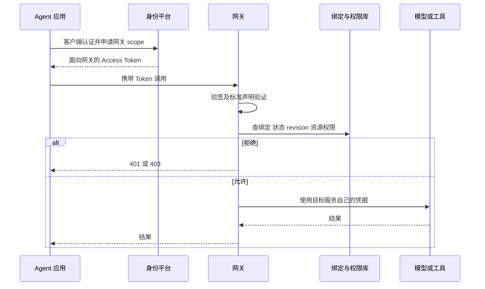
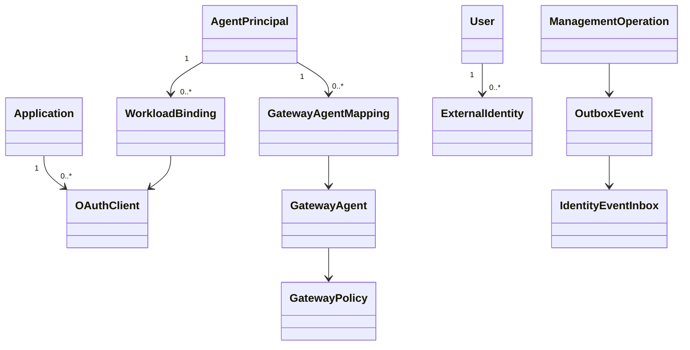

# 独立身份平台与 AI 治理网关对接设计说明书

2026-11-20 更新说明。整体改造决策、三方责任边界、SDK 与 DPoP 规划见 [SOLUTION.md](SOLUTION.md)。本文保留原详细设计，新增配置和接口仍按目标态理解，交付状态以主方案和验证记录为准。

文档版本 1.0，更新日期 2026-11-19。源码基线为 `853292abe599cacf0e86786105ef10d311740f16`，实施分支为 `litellm_identity_platform_integration`。

## 1. 文档范围与交付状态

本文面向平台开发、网关开发、Agent 平台开发、测试与部署人员，约定独立身份平台的目标架构、接口、数据归属、认证授权、安全边界、兼容策略与实施验收。文中的“拟新增”“目标”均为设计要求，不表示对应功能已经实现。接口和配置示例不能直接作为当前版本已支持的接口使用。

| 能力 | 基线状态 | 证据与限制 |
| --- | --- | --- |
| 独立身份核心 | 已有开发部署 | 本目录 Compose，Keycloak 26.4.7 与独立 PostgreSQL |
| 原生用户和应用管理 | 已验证部分操作 | smoke.py 验证创建、查询、用户禁用及应用令牌签发 |
| 网关 JWT 验证组件 | 已与真实身份核心令牌联调 | 实际 JWKS 验签，错误 audience 拒绝 |
| 外部 Agent 声明分类 | 已接入既有 Agent 身份路径 | 自主工作负载支持，真实令牌主体和 scope 测试通过，数据库及完整 HTTP 待验收 |
| 现有 Agent 身份和授权回归 | 2026-11-18 测试通过 | 与新增模块合计 320 项，不等于端到端验收 |
| 外部用户网页登录 | 待实现与端到端验证 | 现有通用 SSO 是可复用基础 |
| 外部应用与 Agent 完整 HTTP 调用 | 待接入 | 组件验签成功不能替代业务授权验证 |
| 统一管理 API、管理页面、同步 | 待实现 | Keycloak 原生管理 API 不等于本文拟定义的产品 API |
| 生产部署及真实 Entra 联邦 | 未验收 | 当前仅回环 HTTP 开发环境 |

已有验证详见 [VALIDATION.md](VALIDATION.md)，当前复用方案与配置步骤见 [GATEWAY_INTEGRATION.md](GATEWAY_INTEGRATION.md)。

## 2. 目标与边界

建设可独立启动、独立升级、独立管理的统一身份平台，为网关、Agent 平台及其他产品提供一致的人类用户、应用和 Agent 身份。代码暂放网关仓库 `identity-platform/`，不得依赖运行中的网关进程才能启动。

所有管理能力采用 API 优先方式。身份平台自己的管理页面、网关管理页面及其他系统均通过同一授权与审计契约操作身份对象。平台是身份主数据的权威来源，网关只保存映射、投影与网关专属权限。

保持原有用户认证为默认行为，现有 Entra 绑定继续可用。未绑定身份的 Agent 不强制迁移、不自动要求外部 Token。“不做 Agent 身份认证”仅表示不增加工作负载身份校验，原有网关调用者认证、访问权限、预算和限流仍执行。

自建平台签发自己的令牌，不冒充 Microsoft issuer。Entra 可作为上游身份源，也可保留网关原有 Entra 直连。完全离线时，本地用户与自主应用可以工作，但不能完成新的 Microsoft 在线登录。

第一期不重写 OAuth 密码学实现，不集中搬迁各产品业务数据库，不将 A2A 接入类型当成身份类型，也不承诺改造远端 Agent 的任务执行引擎。

## 3. 总体架构



身份核心采用 Keycloak。自研管理 API 封装产品对象与受限操作，通过管理 API 调用核心，不直接写 Keycloak 内部表。协议核心、管理服务、界面和网关可以独立发布。

建议目录按 `core/`、`admin-api/`、`admin-ui/`、`contracts/`、`deploy/`、`tests/` 演进。现有 compose.yaml、realm.json、smoke.py 继续作为开发入口。具体依赖版本在实施阶段锁定并保留校验信息。

数据库可共用 PostgreSQL 实例，但身份核心、管理服务和网关应使用独立数据库或 schema 与独立账号。Redis 仅用于可恢复缓存和协调，不作为身份主数据唯一存储，也不代替 Keycloak 自身的会话管理。

## 4. 领域对象和数据归属

| 对象 | 定义 | 权威位置 |
| --- | --- | --- |
| User | 人类用户的稳定主体 | 身份平台 |
| ExternalIdentity | 外部 issuer 与 subject 的绑定 | 身份平台 |
| Application | 接入产品，如网关或 Agent 平台 | 身份平台 |
| OAuthClient | 控制台、后台任务等协议客户端 | 身份核心 |
| Resource | API audience 和可授予 scope | 身份平台与核心 |
| AgentPrincipal | 智能体工作负载身份、所有者和状态 | 身份平台 |
| WorkloadBinding | Agent 与客户端、主体、公钥的关系 | 身份平台 |
| Grant | 主体对应用或资源的授权 | 身份平台 |
| GatewayAgent | A2A/厂商类型、上游地址、调用参数 | 网关 |
| GatewayPolicy | 模型、工具、预算、限流、网关角色 | 网关 |

一个 Application 可有多个 OAuthClient。每个需要独立治理的 Agent 初期分配独立客户端，避免共享密钥导致无法独立撤销。凭据轮换允许受控重叠，但稳定 Agent ID 不变。

用户主键不得使用邮箱。产品映射使用可信 `issuer + sub`。提供商采用 pairwise subject 时，不假定跨客户端 sub 相同，使用平台受控稳定主体标识或明确映射。相同邮箱不得自动合并账号。

Entra、LDAP 等上游拥有的字段需声明只读或经专用上游操作更新。平台禁用本地访问不等于修改上游账号。

## 5. 兼容模式与配置选择

用户网页登录、API 凭据策略、Agent 身份提供商、身份管理接入必须分别配置。缺省配置严格走旧路径。

| 场景 | 行为 |
| --- | --- |
| 缺省或 legacy | 保持既有本地、SSO、API Key 和 JWT 配置语义 |
| 用户 external_oidc | 仅使用指定外部登录提供商 |
| 普通未绑定 Agent | 保持原网关认证和授权，不附加受管身份要求 |
| microsoft_entra Agent | 保留既有 tenant、azp、oid、roles、scp 规则 |
| external_oidc Agent | 启用新 profile 和绑定检查 |
| 已受管 Agent 解绑 | 禁用或要求明确迁移，不自动降级为普通 Agent |
| 外部身份失败 | 拒绝，不自动尝试本地密码或普通 Agent 路径 |

以下是目标配置，当前尚未实现。

```yaml
general_settings:
  authentication:
    user_auth:
      mode: external_oidc
      provider: corporate_identity
      provisioning: approved_only
      local_login_enabled: false
    api_auth:
      mode: explicit
      virtual_keys_enabled: true
      jwt_providers: [corporate_identity]
    providers:
      corporate_identity:
        type: oidc
        issuer: https://identity.example.internal/realms/company
        profile: unified_identity_v1
        login:
          client_id: gateway-console
          client_secret: os.environ/GATEWAY_OIDC_CLIENT_SECRET
          redirect_uri: https://gateway.example.internal/auth/oidc/callback
          scopes: [openid, profile, email]
        api:
          audiences: [ai-governance-gateway]
  identity_management:
    mode: external
    provider_id: corporate_identity
    management_api_base: https://identity.example.internal/api/v1
    service_client:
      client_id: gateway-identity-integration
      credential_ref: os.environ/IDENTITY_INTEGRATION_SECRET
    synchronization:
      enabled: true
      events_enabled: true
      reconciliation_enabled: true
```

新配置与旧 GENERIC_* 等配置冲突时明确报错，不按环境变量出现顺序猜测。配置不得从请求体接受任意 issuer/JWKS 地址。第一期通过文件、环境变量及受控重启应用信任配置。

外部登录关闭本地入口时，应有独立审计的运维恢复流程。已有 Master Key 和 API Key 的行为由 API 策略显式控制，不随 UI 登录模式偷偷变化。

## 6. 用户登录与会话



授权码一次性使用，state、nonce 和 PKCE verifier 与登录事务绑定并短期保存。回调地址精确匹配白名单，return_to 仅允许站内路径。登录选择的提供商在回调时再次绑定，避免多 IdP 混淆。

外部 Refresh Token 只保存在服务端受保护存储，不写浏览器 localStorage，不放 URL。Cookie 设置 Secure、HttpOnly 和适用的 SameSite，修改类请求校验 CSRF。ID Token 只用于登录身份确认，不能作为业务 API Access Token。

首次登录默认 approved_only，由预配置或管理员批准建立本地用户映射。可选 JIT 只创建最低权限用户，外部角色必须经显式允许列表映射，禁止自动赋予管理员。

注销分别处理本产品会话与身份平台会话。跨产品退出需要后端注销通知或状态同步，删除浏览器 Cookie 不等于全局撤销。

## 7. 应用与 Agent 认证

自主应用通过 Client Credentials 取得令牌。优先支持 private_key_jwt，初期可使用可轮换客户端密钥。客户端私钥由工作负载持有，网关不保存私钥。

应用 Token 与 Agent Token 均需合法签名和正确 audience。普通应用按应用授权处理；Agent 还需匹配注册绑定。不能通过请求中填写 agent_id 将普通应用升级为 Agent。

Agent 执行模式保留 autonomous、delegated、both。both 允许两类请求，但每个请求仍必须确定具体模式。通用身份适配器不得使用“没有 scp 就是应用”作为唯一判断。



工作负载绑定目标示例。

```json
{
  "identity": {
    "provider": "external_oidc",
    "provider_id": "corporate_identity",
    "client_id": "contract-agent",
    "subject_id": "workload-123",
    "required_scopes": ["gateway.invoke"]
  },
  "execution_mode": "autonomous"
}
```

上述结构待实现，既有 Entra 请求结构继续兼容。调用目标 Agent 与调用者 Agent 分别记录，费用主体另行解析，避免把 invoked_agent_id 当成调用者身份。

## 8. 委托调用与令牌契约

用户先登录 Agent 平台，获准的客户端通过受控 Token Exchange 获得面向网关的短期令牌。平台验证 subject token、请求客户端、目标 audience、scope 和委托授权。不可任意扩大权限，不接受客户端自报用户或 Agent 主体。

Keycloak 标准交换的同 realm 场景作为第一期基础。Entra 先通过联邦登录转换为平台身份，再使用内部交换。选定版本对 actor 声明、scope 收窄和调用方绑定的实际支持需要先做协议验证，不依赖旧版 preview 交换实现。

| 字段 | 校验或用途 |
| --- | --- |
| iss | 精确匹配预配置提供商 |
| aud | 与当前 API 资源匹配 |
| sub | 非空、按 profile 解析主体 |
| exp、nbf、iat | 有效时间与受限时钟偏差 |
| jti | 审计与撤销定位 |
| azp/client_id | 按 provider profile 解析，不接受随意互换 |
| scope | 检查必需 scope，scope 不替代资源权限 |
| identity_kind | 平台私有 profile 的 human/workload/delegated 分类 |
| act | 委托执行者信息，必须由可信签发端生成 |

现有 external_identity.py 只是已验签 claims 的策略分类器，不能直接用于验证原始 JWT。目标代码必须先完成密码学验证和令牌类型检查，再调用该分类器。

权限为主体准入、令牌 scope、用户授权、Agent 授权和目标资源规则的共同限制，不能简单把用户权限和 Agent 权限做并集。模型调用不得复用面向 identity-management-api 的 Token。

## 9. 统一管理 API

目标基础地址 `/api/v1`。这些是产品管理接口，与 Keycloak `/admin/realms/...` 原生接口不同。发布 OpenAPI、版本化错误契约和 Python/TypeScript SDK。管理 API 不能将任意上游 Admin API 路径原样转发。

| 方法与路径 | 能力 |
| --- | --- |
| POST /users | 创建或预创建用户 |
| GET /users、GET /users/{id} | 分页查询及详情 |
| PATCH /users/{id} | 修改非上游权威字段 |
| POST /users/{id}/enable、disable | 启停本平台访问 |
| POST /users/{id}/revoke-sessions | 撤销会话 |
| POST /users/{id}/required-actions | 要求改密、MFA 等 |
| GET /users/{id}/external-identities | 查看外部绑定 |
| POST /users/{id}/deletion-requests | 受控删除申请 |
| POST /applications、GET /applications | 注册与查询产品 |
| GET、PATCH /applications/{id} | 详情与元数据更新 |
| POST /applications/{id}/clients | 注册 OAuth 客户端 |
| GET、PATCH /clients/{id} | 查询与修改协议配置 |
| POST /clients/{id}/credentials/rotate | 轮换凭据 |
| POST /clients/{id}/credentials/{credential_id}/revoke | 撤销指定凭据 |
| POST /applications/{id}/resources | 注册 API 资源 |
| POST /resources/{id}/scopes | 定义资源 scope |
| POST /agents、GET /agents | 创建及查询 Agent 身份 |
| GET、PATCH /agents/{id} | 查询及修改 Agent |
| POST /agents/{id}/enable、disable | 身份启停 |
| POST /agents/{id}/workload-bindings | 绑定工作负载 |
| DELETE /agents/{id}/workload-bindings/{id} | 撤销绑定 |
| POST /agents/{id}/credentials/rotate | 轮换工作负载凭据 |
| POST /agents/{id}/deletion-requests | 受控删除 |
| POST、GET /grants、DELETE /grants/{id} | 管理授权 |
| GET /audit-events | 审计查询 |
| GET /operations/{id} | 异步操作状态 |
| POST /event-subscriptions | 注册授权事件订阅 |
| GET /changes?cursor=... | 增量同步 |

创建成功返回 201 与对象 ID，异步操作返回 202 与 operation_id。PATCH 使用 If-Match，版本不匹配返回 412。请求结构错误返回 400/422，未认证 401，无权限 403，资源不存在 404，业务冲突 409。跨租户查询可统一返回 404，避免泄露对象存在性。

写入支持 Idempotency-Key，键作用域包括租户、客户端和操作。相同键不同请求体拒绝，相同请求重放返回原结果。错误结构包含 code、message、request_id 和字段错误，不能返回上游密钥或原始 Token。

```json
{
  "id": "agt_123",
  "tenant_id": "tenant_1",
  "display_name": "合同审核助手",
  "status": "active",
  "version": 18,
  "operation_id": "op_456"
}
```

scope 划分 users.read/write/disable、applications.read/write、agents.read/write、credentials.rotate、grants.manage、audit.read 等，并叠加 tenant、所属应用和对象范围。普通应用编辑权限不自动允许改变回调地址、授权类型或授予高权限 scope。

服务账号用于后台同步。管理员从网关发起的操作使用受控委托身份并记录人类操作者。不能只信任客户端提交的 X-User-ID。引导管理员不用于长期集成，密钥不下发前端。

## 10. 网关统一管理与同步

网关页面区分身份平台字段与本地业务字段。身份编辑写平台，模型、工具、预算与网关角色写本地。身份平台是唯一权威源，多个产品是多个写入入口，不形成双向主数据覆盖。

管理操作响应展示平台版本与网关已应用版本。平台不可用时可查看带时间戳的缓存，但写操作不能假装成功。确需排队时显示 pending，执行前重新验证权限和版本。

同步使用事件通知、游标增量拉取、周期性全量对账。事件至少一次投递，消费者按 event_id 去重，并按 entity_version 拒绝旧版本覆盖。

```json
{
  "event_id": "evt_123",
  "tenant_id": "tenant_1",
  "entity_type": "agent",
  "entity_id": "agt_123",
  "entity_version": 18,
  "event_type": "agent.disabled",
  "occurred_at": "2026-11-19T00:00:00Z",
  "operation_id": "op_456",
  "origin_application_id": "gateway",
  "schema_version": 1
}
```

事件不含凭据。投递端只允许预配置目标，校验签名、时间戳和重放窗口，禁止任意 Webhook 地址导致 SSRF。接收方持久化 inbox 后确认接收，再异步应用。失败重试、死信、游标过期和快照重建均必须可观察。

快照需关联增量游标，避免快照期间遗漏写入。增量权限按租户和订阅范围过滤。删除使用墓碑记录，避免断线消费者重新恢复已删对象。

数据库业务写与 Outbox 可在管理业务库内同事务提交。调用 Keycloak 与本地数据库之间没有分布式原子事务，采用 pending/applying/active/failed 状态机、幂等操作和补偿。只有身份核心已成功应用后才发布对应完成事件。

## 11. 数据模型与一致性

| 目标表或集合 | 保存内容与约束 |
| --- | --- |
| ExternalIdentityMapping | issuer、subject、tenant、本地 user_id，唯一绑定 |
| ExternalAgentBinding | provider、issuer、client、工作负载主体、agent_id、active、revision |
| IdentityObjectProjection | 网关只读摘要、源版本、同步时间 |
| IdentitySyncCheckpoint | 每订阅游标和快照状态 |
| IdentityEventInbox | event_id 唯一、处理结果、重试次数 |
| IdentityManagementOperation | 请求摘要、幂等键、状态、执行者和错误 |
| PlatformAgentPrincipal | 稳定 Agent ID、owner、执行模式、启停状态 |
| PlatformExternalReference | 产品本地 ID 与平台对象关系 |
| OutboxEvent | 事务内待发布变更 |
| EventSubscription | 租户、目标、过滤规则与投递授权 |
| AuditEvent | 操作者、应用、对象、操作和结果 |



新表采用增量迁移，旧 Entra 表和主键保留。存量用户绑定不按邮箱批量猜测，不迁移密码。清理历史记录遵循明确保留周期，审计数据可保留匿名稳定引用。

新数据库操作遵循仓库 database-access 技能，放在 repository 中，路由通过依赖注入获取接口。复用生命周期连接，不为每个请求开连接。此次不附带迁移 Prisma 至 Rust。

## 12. Agent 创建、解绑和删除

先有平台身份时，网关同步为“身份已登记，服务待配置”，待管理员补全上游类型、地址及权限后激活。不得从身份对象猜测 A2A 地址。

网关一站式创建时，先申请平台身份，再保存网关配置和映射，验证后激活。跨系统失败保留 operation_id 并允许继续处理。重试不重复创建。被其他产品引用的身份不能因网关保存失败而直接删除。

已受管 Agent 解绑后默认保持受管标记且禁用。变回普通 Agent 是独立、审计的迁移操作，需重新检查凭据、权限和产品引用。外部身份验证失败不能触发此迁移。

平台禁用身份限制后续准入，不等于终止外部正在执行的任务。远端 Kill Switch 与身份撤销是独立动作，各自记录结果。

## 13. 缓存、撤销和故障策略

Access Token 目标有效期 5 分钟，可配置。短期 JWT 不天然支持即时撤销。强撤销接口需在线状态检查或版本化撤销状态，明确可接受延迟。

| 故障 | 处理 |
| --- | --- |
| 签名、audience、issuer 不符 | 拒绝，无认证降级 |
| 未知 kid | 限频刷新可信 JWKS，仍未知则拒绝 |
| IdP 暂时不可用 | 有界缓存公钥可验证未过期令牌，新登录和换令牌失败 |
| 策略库不可用 | 受管身份按失败关闭处理，不转普通 Agent |
| 事件丢失 | 增量拉取和对账补偿 |
| 重复或乱序事件 | inbox 去重和对象版本比较 |
| 身份绑定发生变化 | revision 不一致拒绝旧上下文 |
| 网关缓存过期 | 重新获取权威状态，不无限沿用旧授权 |

密钥轮换保留适当的公钥重叠窗口，紧急密钥泄露场景强制撤销。JWKS 缓存键包含 issuer，限制缓存大小和刷新频率。认证日志只记录必要主体标识及失败原因，禁止记录完整 Token、授权码或密码。

## 14. 代码改造清单

| 源码区域 | 目标修改 |
| --- | --- |
| litellm/proxy/management_endpoints/ui_sso.py | 显式登录模式、回调及稳定用户映射 |
| litellm/proxy/auth/handle_jwt.py | 复用验签与 issuer 配置，标准化可信身份 |
| litellm/proxy/auth/user_api_key_auth.py | API 凭据分派，失败不跨类型降级 |
| litellm/proxy/auth/external_identity.py | 已验签 profile 分类器接入，不替代 JWT 验证 |
| litellm/types/proxy/agent_identity.py | 增加外部 OIDC 类型，保留 Entra |
| agent_endpoints/managed_identity.py | provider 专用策略分派 |
| agent_endpoints/identity_store.py | 通用绑定查询与主体登记 |
| agent_endpoints/auth/managed_authorization.py | 标准上下文、版本与权限检查 |
| management_endpoints/sso/agent_subject_enrollment.py | 可信外部用户登记 |
| repositories、deps、schema 与 migrations | 映射、inbox、checkpoint 与事务操作 |
| ui/litellm-dashboard | 登录选项、身份管理页、差异字段及同步状态 |
| identity-platform | 管理 API/UI、契约、同步服务、部署和测试 |

不要在 HTTP 适配器里散落 provider 判断，不复制现有 JWT 实现。使用显式 tagged union 和冻结类型描述认证结果。未知 provider 或不支持的 profile 应拒绝并提供可诊断错误。

## 15. 部署与镜像关系

身份平台独立部署，网关不可把身份数据库当自己的业务数据库。生产目标为内网 HTTPS、固定镜像版本及摘要、独立卷、备份恢复、最小权限管理员和健康检查。

当前 compose.yaml 使用 start-dev、回环 HTTP 和随机本地凭据，仅用于开发。realm.json 首次导入不覆盖既有 realm，后续变更通过受控管理 API 或版本化迁移执行。不得使用 admin-cli 密码授权烟测方法作为生产产品登录方案。

网关镜像拆分与身份平台独立发布。UI 静态资源由 Nginx 提供，Python 核心使用完整接口入口，Rust wheel 为构建产物，不是身份服务。身份认证配置修改不应要求重新编译 Rust。

部署需关联网关公开域名、反向代理、可信转发头和 OIDC redirect_uri。issuer 必须使用所有验证端可达且稳定的地址，不能在跨容器部署中误用指向各自容器的 127.0.0.1。

离线包包括身份平台与网关镜像 tar、SHA256、Compose、配置模板、内部 CA 导入说明、数据库迁移、备份恢复与运维手册。禁止导出测试 .env、生产密钥或数据库运行卷进入源码。

备份分别覆盖身份核心库、管理业务库和网关映射，记录一致性时间点。恢复后先停事件消费，核对身份版本和游标，再重建投影和恢复服务。Redis 缓存丢失应可恢复。

## 16. 实施阶段与验收矩阵

| 阶段 | 交付与退出条件 |
| --- | --- |
| A 协议基线 | 锁定核心版本，验证 OIDC、应用令牌、交换与 profile |
| B 管理平台 | 用户、应用、Agent API，权限、幂等、审计和独立部署 |
| C 用户接入 | legacy 默认不变，外部网页登录和会话完整通过 |
| D 工作负载接入 | 应用及 Agent 完整 HTTP 调用，委托和撤销通过 |
| E 同步管理 | 网关可管理平台对象，事件丢失可恢复 |
| F 交付 | 隔离端到端、生产配置、离线包与恢复演练 |

| 验收场景 | 预期 |
| --- | --- |
| 不配置新模式 | 旧登录、Key、未绑定 Agent 行为保持 |
| 外部登录成功与错误回调 | 成功映射，state/nonce/PKCE 错误拒绝 |
| 同邮箱不同 issuer/sub | 不错误合并 |
| ID Token 调用业务 API | 拒绝 |
| 错误 aud/iss/kid/过期 Token | 拒绝并安全记录原因 |
| 应用请求未授权管理接口 | 拒绝 |
| 自主 Agent 主体不匹配 | 拒绝 |
| 委托缺少用户或 actor 证明 | 拒绝 |
| 有效身份但模型/MCP 无权限 | 拒绝 |
| 受管身份失败 | 不回退普通 Agent |
| 禁用、解绑、版本变更 | 后续调用按撤销 SLA 拒绝 |
| 管理 API 跨租户请求 | 拒绝且不泄露对象 |
| 两系统同时编辑 | 412，不静默覆盖 |
| 幂等创建与跨系统失败 | 不重复，操作可恢复 |
| 重复/乱序/丢失事件 | 一致性可恢复 |
| 新旧密钥轮换 | 合法窗口通过，撤销后拒绝 |
| 平台故障与缓存到期 | 不无限延长信任 |
| 浏览器退出与跨产品注销 | 达到约定会话撤销效果 |

单元测试使用固定时间及受控输入。集成测试使用本地身份核心与测试数据库，业务模型使用 mock，不发送真实模型请求。端到端必须覆盖真实浏览器登录回调、HTTP 推理及工具授权，不能用直接调用 JWTHandler 替代。真实 Entra 需要专用测试租户，未测则明确标注。

每份验收记录写明源码 SHA、镜像摘要、命令、环境、成功/失败/未测及清理结果。性能指标应在指定并发和数据规模下测量后确定，不预先声称延迟或吞吐达标。

## 17. 灰度、迁移和回滚

先部署平台与只读同步，再小范围开启管理写入，最后按用户组和 Agent 分批切换外部认证。迁移前保存用户与 Agent ID 映射，检测冲突。已管理身份的安全属性不能因回滚而自动丢失。

回滚用户登录可切回 legacy，但只恢复预先批准的旧认证路径。外部受管 Agent 应禁用或恢复已验证旧绑定，不能直接改成匿名。数据库采用扩展式迁移，回滚应用不删除新表和审计。关闭消费者时保留 checkpoint，恢复后执行对账。

## 18. 运行观测与维护

记录登录成功率、按原因分类的拒绝数、JWKS 刷新失败、管理 API 延迟、同步积压、版本落后、死信和撤销传播延迟。审计关联 request_id、operation_id、event_id、主体、客户端和目标资源，但不记录敏感令牌。

管理员可查询平台对象版本、网关投影版本、最近同步时间和失败原因。健康检查分存活、就绪、身份核心可达性和同步状态，不能因外部 IdP 短暂故障让所有存活检查失败并反复重启。

## 19. 协议依据与待确认实现细节

以下是设计依据，不表示本项目已通过全部协议一致性认证。

- [OpenID Connect Core](https://openid.net/specs/openid-connect-core-1_0.html)，用于用户登录身份。
- [RFC 9700](https://www.rfc-editor.org/rfc/rfc9700.html)，OAuth 安全最佳实践。
- [RFC 7636](https://www.rfc-editor.org/rfc/rfc7636.html)，PKCE。
- [RFC 8693](https://www.rfc-editor.org/rfc/rfc8693.html)，Token Exchange。
- [RFC 7519](https://www.rfc-editor.org/rfc/rfc7519.html)，JWT。
- [Keycloak 管理文档](https://www.keycloak.org/docs/latest/server_admin/index.html)，身份核心与身份代理。
- [Keycloak Token Exchange](https://www.keycloak.org/securing-apps/token-exchange)，选定版本需验证支持范围。
- [A2A 协议](https://a2a-protocol.org/latest/specification/agent-card/)，智能体发现与交互，不能替代身份授权。
- [MCP 授权规范](https://modelcontextprotocol.io/specification/2025-06-18/basic/authorization)，工具服务的授权边界。

实施前需要通过测试定案的细节包括 Keycloak actor 输出扩展、统一主体跨客户端映射、撤销时限、事件保留窗口、多租户隔离方式及真实 Entra 联邦配置。缺少这些验证不应阻止普通未绑定 Agent 沿用旧流程，但应阻止未经验证的新受管模式进入生产。
