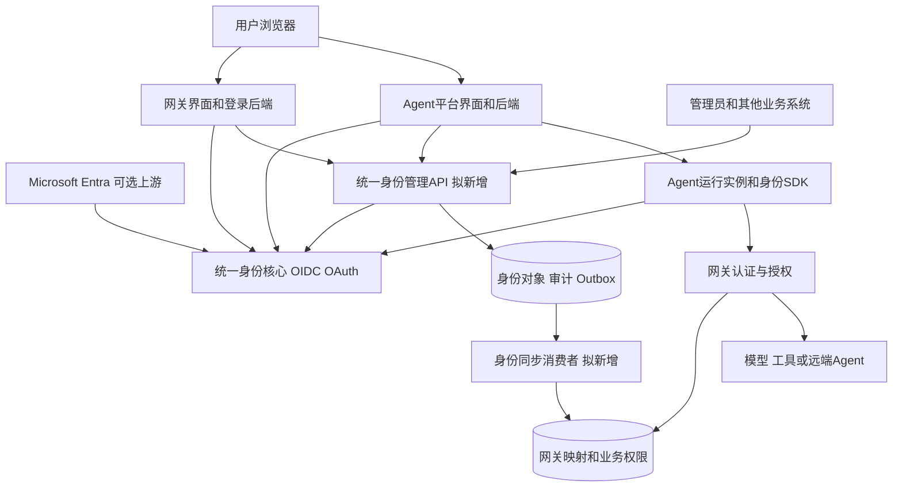
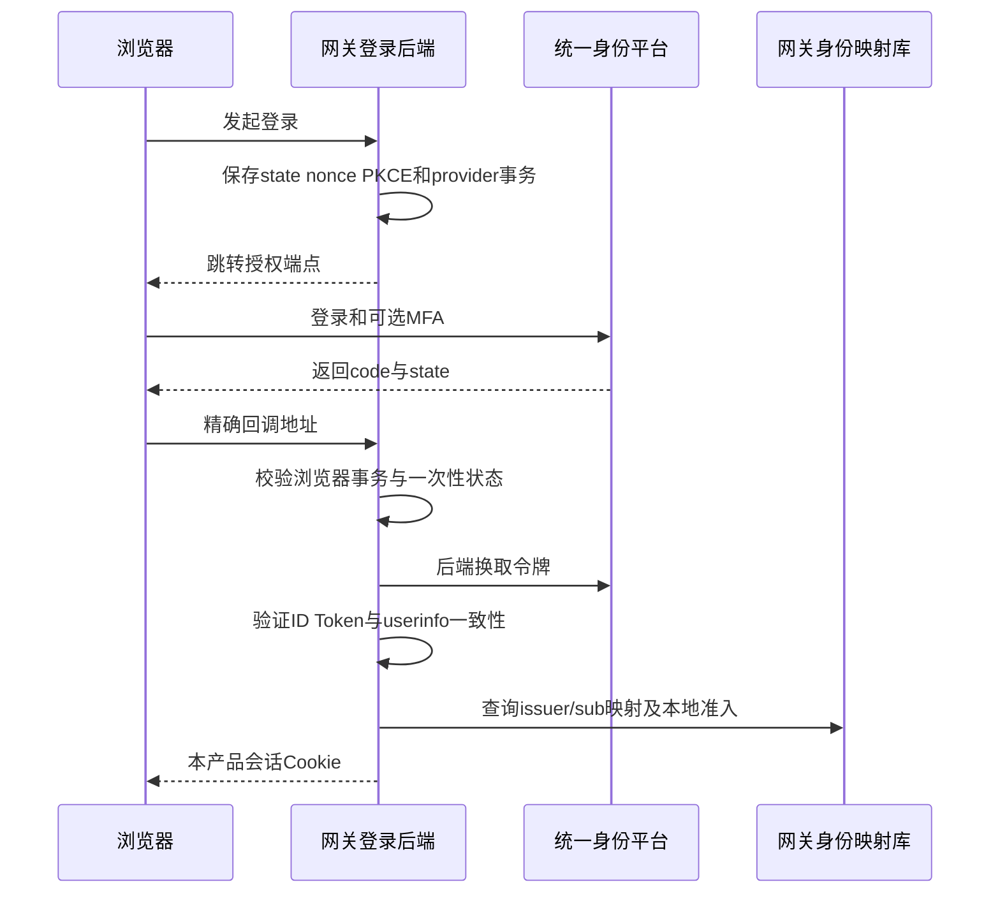
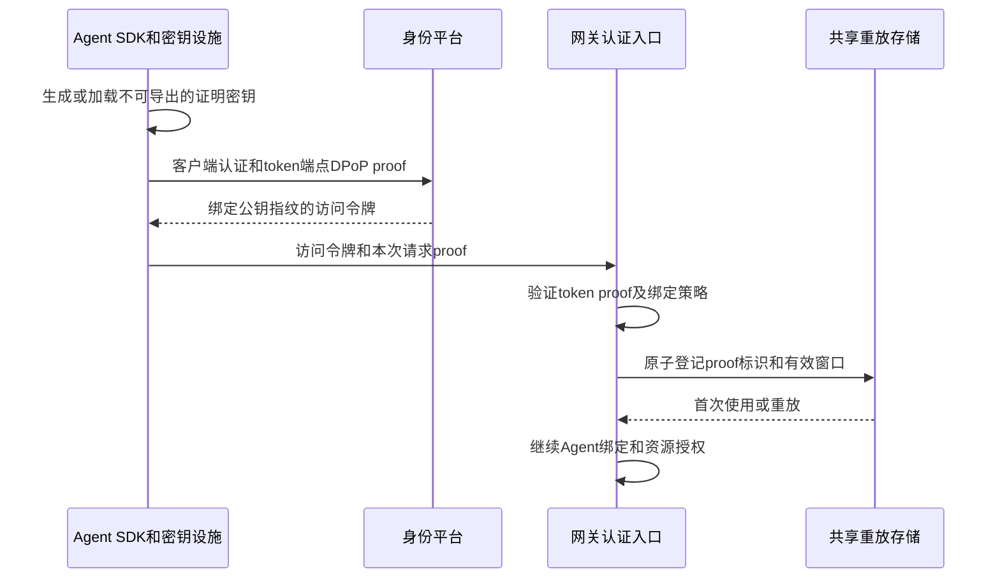

# 网关、统一身份平台与 Agent 平台统一认证解决方案

版本 2.0，2026-11-20。核对基线为 `b6ede959d691d1a8b3dc311cebac9e5ad198378d`，分支为 `litellm_identity_platform_integration`，仓库为 `jhzhfree/litellm`。本次先从远端 fast-forward 到该提交，再核对源码。本文件只定义方案及实施边界，不表示新增接口、SDK、DPoP 已交付。

本文作为整体改造主文档。当前接入步骤见 [GATEWAY_INTEGRATION.md](GATEWAY_INTEGRATION.md) 和 [INTEGRATION.md](INTEGRATION.md)，历史详细设计见 [DESIGN.md](DESIGN.md)，测试证据见 [VALIDATION.md](VALIDATION.md)。出现状态差异时，以本文件基线核对结果及带日期的验证记录为准。所有“拟新增”“目标”接口、配置、包名均不得直接当作当前功能使用。

## 1. 结论与建设目标

统一身份平台可以作为网关的外部 SSO 系统。它承担 OIDC Provider / OAuth Authorization Server 角色，网关承担登录客户端和 API 资源服务器角色，Agent 平台承担工作负载管理及 OAuth 客户端角色。统一身份平台可通过联邦接入 Microsoft Entra，也可服务本地用户。平台使用自己的 issuer 签发令牌，不冒充 Microsoft。

改造继续复用网关现有通用 SSO、JWTHandler、Agent 身份存储和授权链路。网关负责本产品内“可以访问什么”，统一身份平台负责“是谁、凭证是否有效、可以获得什么目标令牌”，Agent 平台负责“哪个运行实例使用哪个身份、如何保护凭证、如何正确发起请求”。同一个身份平台不意味着所有产品共用一个客户端、一种 audience 或同一管理员权限。

默认保留当前用户认证方式和未绑定身份的旧 Agent。外部认证通过显式配置开启。应用身份、Agent 身份、人类用户身份分别建模，不将邮箱、Agent 名称、调用目标 ID 当作可信身份主键。

## 2. 当前实现与尚未实现的能力

| 能力 | 基线实际状态 | 边界 |
| --- | --- | --- |
| 独立身份核心 | `identity-platform/compose.yaml`，Keycloak 26.4.7 与独立 PostgreSQL | 回环 HTTP、start-dev，尚非生产部署 |
| 用户和应用管理 | Keycloak 原生页面及管理 REST API | 尚无产品统一管理 API、Agent 主数据服务 |
| 网关用户外部 SSO | 已有 GENERIC_*、授权码和 PKCE；严格模式缺 state 拒绝 | Chromium 登录真实 Keycloak 后拦截回调，再调用网关组件通过；没有完整网关数据库及控制台会话验收 |
| 网关 JWT | 现有签名、issuer、audience、JWKS 路径 | 真实 HTTP 分派有 enable_jwt_auth 和 premium_user 功能门控，不能用 JWTHandler 烟测替代产品入口验收 |
| 外部自主 Agent | external_oidc 已接入请求身份解析与分类 | 校验 issuer、azp、sub、identity_kind、scope；数据库完整 HTTP 链路待验收 |
| Agent 管理页面 | 外部提供商创建、编辑、详情及中英文文案已实现 | 管理的是网关绑定，不自动创建身份平台应用 |
| Entra Agent | 保留既有自主和委托实现 | 真实 Entra 租户联调没有本轮证据 |
| 外部委托 Agent | 当前明确拒绝 delegated 和 both | 分类模块中有部分声明处理不等于生产委托认证完成 |
| 生命周期控制 | 绑定版本、禁用、解除绑定及退役记录已有代码 | 不等于全局令牌即时撤销或远端任务终止 |
| SDK、自动开户与同步 | 尚未实现 | 本文定义新契约 |
| DPoP | 当前核对的入站认证路径无相应验证器 | 全部属于后续规划，不能把 Bearer JWT 宣称为持有者绑定令牌 |

历史验证包括后台分类授权 327 项、身份存储 42 项通过和 4 项缺 Prisma 模型失败、前端相关 52 项、PKCE 相关 39 项。数字来自既有验证记录，本次文档任务未重新运行测试。Prisma 官方下载此前返回 403，数据库联调缺口尚未解除，禁止通过跳过校验、伪造数据库结果或绕过网络规则将其标为完成。

## 3. 系统结构与信任边界



公网不是部署要求。生产 issuer 可以是企业内网 HTTPS 域名，但浏览器、网关、Agent 必须看到同一签发者标识并能访问所需端点。不要把同一 issuer 改写为容器内部地址，也不要将任意请求携带的 jku、JWKS URL 或 discovery URL 用作信任配置。

网关到远端 Agent / 模型的出站认证独立管理。入站用户或 Agent 的令牌不会自动成为上游凭证。若上游要求用户委托，应另行取得目标 audience 令牌。A2A、MCP、LangGraph 等运行协议不替代 OAuth 身份验证。

## 4. 明确责任矩阵

| 工作 | 网关系统 | 统一身份平台 | Agent 平台 |
| --- | --- | --- | --- |
| 用户账户、密码、MFA、身份联邦 | 使用外部结果，保留默认本地方式 | 外部模式下的权威管理方 | 接入平台登录，不复制密码库 |
| 浏览器登录事务与本产品会话 | 管理自己的 state、PKCE、回调、Cookie 和退出 | 执行身份验证，签发 code / token，管理 IdP 会话 | 为自己的界面维护独立登录事务和会话 |
| 应用、Agent 主身份及所有者 | 保存映射和网关专属策略 | 提供对象管理 API、主体与凭证生命周期 | 申请对象、标明所有者并关联运行实例 |
| 应用密钥和工作负载私钥 | 不收集 Agent 私钥或长期客户端密钥 | 验证客户端，维护公开凭证及状态 | 从密钥库注入，隔离、轮换和销毁运行凭证 |
| 网关模型、工具、预算、限流 | 最终授权方 | 仅签发允许的资源 scope，不替网关决定账单或模型权限 | 申请最小权限并处理拒绝 |
| Agent 执行、任务取消、实例隔离 | 阻止后续请求，可调用受控 kill switch | 禁止新令牌签发或吊销凭证 | 停止任务、回收实例、阻断本地密钥使用 |
| 身份对象同步 | 消费事件、保存投影、对账并校验版本 | 发布变更事件和查询接口 | 维护本平台投影及资源关系 |
| DPoP | 验证入站 proof、重放和密钥绑定 | 签发与密钥绑定的 token | SDK 持有私钥并逐请求生成 proof |
| 审计 | 记录请求、认证、授权与资源结果 | 记录账户、凭证、授权和签发变化 | 记录部署、实例、任务与 SDK 身份使用 |

平台不可通过一个用户角色直接授予网关全局管理员。管理 UI 只调用同一套管理 API，不能绕过其授权直接写身份核心数据库。Agent 运行实例不得持有身份平台管理客户端凭证。

## 5. 身份对象、唯一性与数据归属

目标主键为 `(issuer, subject)`，内部可另有不可变 `identity_id`。邮箱、用户名和显示名称可变，不能作为自动合并依据。多租户还需绑定已验证的组织关系，不能只相信请求头 tenant_id。不同 issuer 的同名 sub 不得合并。

| 对象 | 目标字段 | 权威方与映射 |
| --- | --- | --- |
| User | identity_id、issuer、subject、状态、组织、可变资料 | 身份平台主数据，网关独立 user_id 和角色映射 |
| Application | application_id、client_id、所有者、允许 audience / scope、凭证元数据 | 身份平台管理，网关保存应用授权关系 |
| AgentIdentity | identity_id、所属 application、workload subject、状态、execution_mode | 身份平台拟新增主对象，网关 agent_id 与之绑定 |
| RuntimeInstance | instance_id、agent_identity_id、部署版本、密钥引用 | Agent 平台管理，不以实例名称作为认证证明 |
| GatewayBinding | provider、issuer、subject、client_id、revision、active | 网关管理；关联资源权限和最近身份匹配记录 |
| Credential | credential_id、类型、公钥指纹、有效期、状态 | 平台记录公开元数据；私钥或密钥材料按机制由工作负载端持有 |

当前网关 `LiteLLM_AgentIdentity` 对 provider/tenant_id/client_id 和 issuer/service_principal_id 有唯一约束。外部模式复用 tenant_id 为 issuer，service_principal_id 为 sub。当前设计近似一个客户端/主体绑定一个网关 Agent。多个独立 Agent 不应共享同一应用令牌，再靠请求体 agent_id 切换身份。第一期每个独立受管 Agent 单独申请身份；多个副本可共享同一逻辑 Agent 的服务身份，但只能得到同一权限。需要副本级审计或隔离时，新增实例主体或独立密钥及认证契约，不偷偷扩大现有唯一性模型。

后续 API 用 issuer、subject_id 的中性字段，兼容层将旧字段转换到内部模型。数据库迁移须显式记录旧新映射、唯一冲突和回滚方式，不把显示名称替换当作身份迁移。

## 6. 用户认证与网关 SSO 改造

### 6.1 统一身份平台作为外部 SSO

网关注册独立 confidential 客户端 `gateway-console`，Agent 平台注册自己的客户端。回调 URI 分别精确登记。平台可对接 Entra；网关既可保留原生 Entra 直连，也可通过统一平台联邦接入。两条路径的 issuer 和 subject 不同，切换时必须执行受控账户关联，不能按邮箱静默合并。

OIDC 提供用户登录身份层；授权码流程与 PKCE 采用成熟协议库，网关后端完成 code 交换和令牌验证。PKCE 的依据为 [RFC 7636](https://www.rfc-editor.org/rfc/rfc7636)，OIDC 登录语义依据 [OpenID Connect Core](https://openid.net/specs/openid-connect-core-1_0.html)。这是目标完整登录契约，不代表现有通用适配器已通过所有安全项验收。



网关改造必须补齐并验证 nonce、ID Token 签名/iss/aud/azp/时间、userinfo sub 一致性以及 provider 与登录事务绑定。不能把单纯解码出的 token claims 用于管理员角色映射。检查现有 GENERIC_INCLUDE_TOKEN_CLAIMS 路径的验证前提，未完成前保持关闭。state、nonce、PKCE verifier 是不同机制，DPoP nonce 又属于另一协议层。

首次登录默认要求预配置或批准。可选 JIT 仅创建最低权限账户。使用 `(issuer, sub)` 外部主体映射表，禁止把多 issuer 的 sub 直接合入同一全局用户命名空间。外部组/角色只能经配置的允许列表映射到网关权限；IdP 的 gateway-user 名称不会自动产生网关权限。

本地会话采用 HttpOnly、生产 Secure Cookie，设置生命周期、CSRF 控制及可信代理 HTTPS 判断。浏览器不保存 IdP Refresh Token 或客户端密钥。SSO 退出包括网关本地退出和可选 IdP 退出；跨产品退出需经过验证的后端注销机制，不能声称删除一个 Cookie 已使所有产品退出。普通页面静态缓存不携带凭证。

### 6.2 当前可用配置

现有 [gateway-sso.env.example](gateway-sso.env.example) 给出 GENERIC_CLIENT_ID、GENERIC_CLIENT_SECRET、三个 OIDC 端点、GENERIC_SCOPE、GENERIC_USER_ID_ATTRIBUTE=sub、GENERIC_CLIENT_USE_PKCE=true、PKCE_STRICT_CACHE_MISS=true 和 PROXY_BASE_URL。生产用同一可信 HTTPS issuer，浏览器经前端反向代理访问后端 `/sso/*`，回调不能指向不存在的 Next.js 页面处理器。

当前通用 SSO 的选择受既有 Google/Microsoft/Generic 配置优先级影响，部署时只能明确启用选定提供商。开启界面 SSO 不会自动开启 API JWT，配置 API JWT 也不会自动配置浏览器 SSO。JWKS 公钥缓存有自己的生命周期，不等同于账户撤销状态缓存。

以下字段在当前代码中存在，示例是单一受信任身份平台的接入起点。域名、密钥引用、回调 URI 必须替换并与部署核对，不是完整生产配置。

```dotenv
GENERIC_CLIENT_ID=gateway-console
GENERIC_CLIENT_SECRET=<由部署密钥设施注入>
GENERIC_AUTHORIZATION_ENDPOINT=https://identity.example.internal/realms/company/protocol/openid-connect/auth
GENERIC_TOKEN_ENDPOINT=https://identity.example.internal/realms/company/protocol/openid-connect/token
GENERIC_USERINFO_ENDPOINT=https://identity.example.internal/realms/company/protocol/openid-connect/userinfo
GENERIC_SCOPE=openid profile email
GENERIC_USER_ID_ATTRIBUTE=sub
GENERIC_CLIENT_USE_PKCE=true
PKCE_STRICT_CACHE_MISS=true
PROXY_BASE_URL=https://gateway.example.internal
JWT_ISSUER=https://identity.example.internal/realms/company
JWT_AUDIENCE=ai-governance-gateway
JWT_PUBLIC_KEY_URL=https://identity.example.internal/realms/company/protocol/openid-connect/certs
```

```yaml
general_settings:
  enable_jwt_auth: true
  litellm_jwtauth:
    user_id_upsert: false
    issuers:
      - issuer: https://identity.example.internal/realms/company
        jwks_url: https://identity.example.internal/realms/company/protocol/openid-connect/certs
        audience: ai-governance-gateway
```

这里的 user_id_upsert 只控制相应 API JWT 用户创建行为，不等于浏览器 SSO 的批准策略已经实现。网关 JWT 功能授权、已登记用户/应用映射、Agent 绑定与资源权限仍需单独满足。多 issuer 场景不能用此单平台例子代替完整信任策略。

配置验收按实际 UI SSO 入口、身份平台登录、`/sso/callback`、网关用户映射、最终 Cookie、受保护页面依次验证，然后再单独验证 Bearer API 请求。浏览器、网关、身份平台应使用统一的对外域名配置；容器 localhost 不互相代表对方。不要把管理员登录客户端与 workload 取 token 客户端合成一个。

### 6.3 拟新增统一配置适配层

以下是目标配置结构，当前不得直接复制到生产配置。首先在配置解析层编译到现有 SSO/JWT 路径，避免创建第二条用户认证实现。

```yaml
identity_integration:
  user_authentication:
    mode: legacy              # 默认保留已有行为，外部模式为 external_oidc
    provider_id: corporate
    provisioning: approved_only
  providers:
    corporate:
      issuer: https://identity.example.internal/realms/company
      ui_client_id: gateway-console
      ui_client_secret_ref: env/GATEWAY_SSO_SECRET
      api_audiences: [ai-governance-gateway]
      trusted_jwks_url: https://identity.example.internal/realms/company/protocol/openid-connect/certs
  agent_authentication:
    legacy_unbound: preserve
    external_modes: [autonomous]
  identity_management:
    enabled: false
    api_base: https://identity.example.internal/api/v1
    service_credential_ref: secret/gateway-identity-manager
```

配置必须有类型校验。显式新配置与旧环境变量冲突时报错，不猜优先级；未配置新结构时完全走原路径。provider 不得由调用方任意指定 URL。管理 API 凭证与 SSO 客户端凭证分离。SSO 迁移保留经过审计的运维恢复账户，关闭外部登录不能自动放开被禁用的受管 Agent。

## 7. 应用与 Agent 凭证完整生命周期

### 7.1 申请、审批与注册

Agent 平台或管理员提交所有者、组织、运行用途、目标资源和最小 scope。统一身份平台创建应用、服务账号和 Agent 主对象，分配不可变主体。当前只能通过 Keycloak 原生管理能力完成前两项；统一 Agent 对象和产品 API 属于后续交付。

注册网关时提供受信任 issuer、客户端 ID、主体和 execution_mode，网关保存绑定并配置模型/工具授权及预算。注册主体和配置业务权限是两个操作。目标事务状态为 REQUESTED、IDENTITY_CREATED、GATEWAY_BOUND、ACTIVE；失败停留在可重试状态，不向前端假报全部完成。

### 7.2 凭证生成和安全交付

初期支持客户端密钥。平台生成或受控轮换密钥，凭证交付给 Agent 平台的密钥库，由调度器注入运行环境。不得将 secret 存入网关 Agent 记录、浏览器存储、Git 或日志。产品管理 API 拟采用一次性提取票据，绑定申请人和目标 workload，短期有效且已使用不能再取；返回只包含必要的密钥材料，普通 GET 不返回 secret。

后续支持 private_key_jwt。私钥由 Agent 平台或工作负载密钥设施产生，平台仅登记公钥。private_key_jwt 证明 token 端点的客户端身份；它本身不将后续 Access Token 变成 DPoP 令牌，两种机制不能混称。

### 7.3 获取、使用与续取令牌

Agent 调用平台 token 端点，使用 client_credentials、客户端认证和已授权 scope。平台检查客户端状态和授权，签发面向网关的短期 Access Token。网关校验签名及信任条件，再执行 Agent 绑定与业务授权。

当前外部工作负载契约为 iss、aud、azp、sub、identity_kind=workload、scope；identity_kind 为本产品 profile，必须由受控 mapper 生成。平台不得把可由用户编辑的个人属性当作 workload 证明。网关的外部绑定 required_roles 当前不支持，使用 required_scopes。

令牌到期前由 SDK 重新使用客户端凭证申请，不依赖人类用户的登录 Cookie。SDK 缓存键包括 issuer、client_id、subject、目标资源、规范化 scope、凭证版本以及未来的 DPoP key thumbprint。凭证轮换或身份禁用使相应缓存失效。

普通应用令牌需要自己的应用授权映射，不能把它升级成 Agent 或管理员。现有 agent_id_jwt_field 属于另一种旧声明映射，不替代 external_oidc 的 issuer/client/sub 绑定。带有未登记 workload 声明时，目标策略要求显式应用准入或拒绝，禁止不经批准回落为人类账户 JIT；这项应补充到入口回归测试。

### 7.4 网关认证及授权顺序

| 顺序 | 网关动作 | 失败行为 |
| --- | --- | --- |
| 1 | 选择预配置认证方式并验证访问令牌 | 不从令牌动态信任新签发者或密钥源 |
| 2 | 精确 issuer / audience、签名、时间和用途校验 | 无效令牌拒绝，不进入资源调用 |
| 3 | 未来按绑定策略校验 DPoP | 要求绑定时不降级到 Bearer |
| 4 | 查 Agent 绑定、enabled、active 和 revision | 禁用、退役、状态不可确认时拒绝 |
| 5 | 匹配客户端、subject、scope 和执行模式 | 不凭名称或请求体 agent_id 获得身份 |
| 6 | 生成受管身份上下文，检查路由与资源权限 | 自主上下文无伪造人类 user_id，也非管理员 |
| 7 | 执行预算、限流、资源调用和审计 | 记录身份认证与业务结果的区别 |

现有 `last_authenticated_at` 是身份匹配证据，不是推理成功记录。同步或请求过程中绑定 revision 改变应拒绝或要求重试。不能把缓存中的上一次允许决定跨越禁用或版本变化继续使用。

### 7.5 轮换、撤销和下线

只轮换客户端密钥而不变更主体时，通常不改网关绑定。变更 client_id 或 sub 时必须更新绑定并产生新 revision，保留旧身份退役信息。网关解绑已有受管 Agent 后保持禁用，不能自动变为旧的无绑定 Agent。

紧急下线由三方分别执行。网关禁用身份阻止后续请求；平台禁用客户端或撤销凭证阻止新令牌；Agent 平台终止实例与任务并清理密钥。已开始的流式请求或远端任务是否中断应有独立策略与实测，不承诺网关状态变化可以撤回已经发送给上游的请求。

本地 JWT 验签不会自动获知身份平台最新撤销结果。目标结合短 token 有效期、签名事件、撤销版本和必要的在线状态查询。交付时必须明确禁用传播 SLO，建议目标为正常状态 30 秒内，状态过期或同步不可用时按受保护资源策略拒绝。该时间是设计目标，不是当前保证。

## 8. 委托用户执行的扩展

当前外部 Agent 仅支持 autonomous。未来 delegated 必须同时证明人类用户、实际执行应用/Agent 和目标资源授权，不能靠传入 user_id 或把应用 token 的 sub 改成人类 ID 实现。

采用受控 Token Exchange，参考 [RFC 8693](https://www.rfc-editor.org/rfc/rfc8693)。统一平台检查 subject token、经过认证的交换客户端、允许的 actor、目标 audience 和 scope 缩减。网关分别记录用户 sub、执行主体 act.sub 或等价经验证 profile、调用者 Agent 和目标 Agent，执行用户权限与 Agent 权限的交集。令牌中的 act 只是声明，可信性必须来自受信任签发及平台授权检查。

Agent 平台不得拿网关 audience 的 token 直接访问另一个产品。需要跨平台执行时，每一跳取得合适资源的令牌；是否允许继续委托、最大深度和可用 scope 由平台策略控制。Entra 原生 OBO 与通用 RFC 8693 不能视为完全相同接口，应由提供商适配器处理。现有 Keycloak 版本对所需 actor 语义、交换限制和持有者绑定的组合能力必须先做验证，再开放 delegated/both。

## 9. 统一管理 API 与跨系统同步

### 9.1 拟新增外部管理契约

下面 `/api/v1` 由身份平台提供，尚未实现。API 用资源服务器专用 audience 和最小管理权限保护。网关管理后端代表已授权操作者调用，不让浏览器持有平台管理员凭证。

| 接口族 | 主要操作 | 调用方与授权边界 |
| --- | --- | --- |
| `/users` | 创建、查询、更新、禁用、邀请/重置动作 | 身份管理员按组织授权，不返回密码 |
| `/applications` | 注册、查询、允许资源和 scope 更新、禁用 | 应用所有者或授权管理员 |
| `/agents` | 主身份注册、所属应用、所有者、状态 | Agent 平台或管理员，不能自授管理权限 |
| `/credentials` | 申请、轮换、一次性领取、撤销、查询元数据 | 独立敏感操作权限，必要时二次验证 |
| `/bindings` | 产品与主体映射、状态、版本 | 对应产品集成客户端，不替网关写业务权限 |
| `/events`、`/changes` | 游标查询、订阅、对账快照 | 仅读取获准组织和对象范围 |
| `/operations/{id}` | 异步跨系统操作及失败补偿状态 | 创建者和授权运维可查 |

创建操作支持 Idempotency-Key 并绑定调用者、请求摘要和保留期；同键异体返回冲突。更新用 ETag/If-Match 防止丢失更新。列表使用稳定游标和组织过滤。错误包含稳定 error_code、request_id 和安全消息，不返回令牌或内部密钥。禁用优先于物理删除，保留审计和 tombstone 防止旧事件复活对象。

### 9.2 事务与冲突边界

平台管理库和 Keycloak 不能假设处于同一个数据库事务。拟采用操作状态机、可重入适配器和补偿。只有核心操作确认后才将对象标为 ACTIVE 并提交本地对象与 Outbox；部分失败记录可重试状态。独立对账发现核心已变但平台未确认的情况，不通过直接写 Keycloak 表修复。

事件至少包含 event_id、schema_version、tenant、object_id、object_version、operation、occurred_at、correlation_id。事件无 secret。消费者验证来源，按 event_id 去重，按对象版本防乱序，删除形成 tombstone，权限扩大和身份切换需要额外审批。采用至少一次投递加幂等消费，不承诺跨网络“恰好一次”。

身份平台是身份属性权威方，网关是网关权限权威方。身份资料更新不能覆盖模型权限；网关授权调整不能回写成为全局管理员。同步断线后使用变更游标和全量对账恢复。禁用事件可触发会话/SDK缓存失效，但事件传递不能替代请求时授权检查。

网关页面的“同步管理身份对象”最终调用上述 API 并展示操作状态，而不在前端分别写两套服务。当前页面仅管理本地 Agent 绑定，开发时必须保留清楚的操作提示。

## 10. SDK 抽象与其他 Agent 平台复用

### 10.1 包边界

拟交付 `identity-sdk-core` 契约、Python SDK 和 TypeScript SDK，先覆盖服务端运行环境。包独立版本发布，不依赖网关 Prisma 模型、Next.js 页面或 Keycloak 管理内部类型。它们不是当前已发布的软件包。

| 模块 | 拟提供的职责 | 明确不做的事 |
| --- | --- | --- |
| OidcLoginClient | 服务端登录事务、回调验证的协议适配 | 不替产品保存会话，不把客户端密钥交给浏览器 |
| TokenProvider | client_credentials、过期前续取、并发合并、缓存隔离 | 不批准注册或自动扩大 scope |
| CredentialProvider | 从 Secret Manager、环境或签名设施读取凭证 | 不把私钥上传网关，不默认落盘明文 |
| ProofSigner | DPoP 或 private_key_jwt 签名，各用独立用途接口 | 不自己定义密码算法 |
| AuthenticatedTransport | 给指定资源附加认证、受控 nonce 重试 | 不跨域转发 Authorization，不自动重放业务写操作 |
| DelegationProvider | 受控 Token Exchange 和委托上下文 | 不接受未经验证的 user_id 冒充用户 |
| IdentityManagementClient | 调用注册、轮换、查询和同步 API | 与运行 SDK 分离，不将管理凭证嵌入 Agent 镜像 |
| ResourceVerifier | 可选的资源端协议验证公共组件 | 不替代各平台自己的 RBAC、租户隔离和账单逻辑 |

抽取时先分离纯声明模型、受信任配置和 HTTP/密钥接口。不要将整个 JWTHandler 连同网关数据库、日志及管理依赖搬进 SDK。密码学、OIDC 发现与签名验证使用成熟库，网关适配器再将标准主体映射为现有 ManagedAgentContext。

使用方式示意，属于 API 草案。

```python
credential = SecretManagerCredential(reference="agents/contract/credential")
identity = WorkloadIdentity(issuer=issuer, client_id=client_id, credential=credential)
transport = identity.for_resource(audience="ai-governance-gateway", scopes=("gateway.invoke",))
response = await transport.post(gateway_url + "/v1/chat/completions", json=payload)
```

SDK 将 resource/audience 参数转换为平台已支持的协议配置；不能假定所有 OAuth token 端点都接受名为 audience 的请求字段。TokenProvider 不以未验证解码结果作授权依据。

### 10.2 其他平台的接入步骤

新平台登记自己的登录客户端与 API audience，为 Agent 申请独立工作负载身份，将 SDK 接入现有 HTTP 客户端，然后在网关申请绑定和资源权限。平台若也接收其他 Agent 调用，需在自己的资源端部署验签与授权模块，不能因为能申请令牌就认为入站已受保护。

Python/TypeScript SDK 使用同一 JSON 契约和正反例测试向量。发布遵循语义版本，支持能力发现、明确的最低服务端版本、旧协议弃用期。无 DPoP 能力的 SDK 只能访问允许 Bearer 的绑定，不能通过兼容选项绕过 required 策略。

SDK 续取采用 single-flight 和过期抖动，避免多个副本同时申请。认证失败最多执行受限的凭证/nonce恢复，不对 403 无限重试。流式响应开始后不自动重新请求模型，非幂等请求和断线重试必须由业务层使用幂等机制决定，避免重复执行和计费。

## 11. DPoP 持有者绑定规划

### 11.1 协议目标和能力门槛

DPoP 将 OAuth 访问令牌绑定到客户端证明密钥，降低仅泄露令牌造成的重放风险。它不替代 TLS、业务授权、客户端认证或实例可信执行证明，也不能阻止同时取得 token 和私钥的攻击者。采用 [RFC 9449](https://www.rfc-editor.org/rfc/rfc9449)，公钥指纹按 [RFC 7638](https://www.rfc-editor.org/rfc/rfc7638) 计算。

协议核对要点是 proof 的 typ=dpop+jwt、非对称签名、公钥、jti、iat、htm、htu；资源请求还需 ath 与 token 的 cnf.jkt 一致绑定。htu 不包含 query 或 fragment。token 端点和资源端可分别发出 DPoP-Nonce，不能混用。网关接收 `Authorization: DPoP <token>` 和 `DPoP: <proof>`，而非把 proof 随意附在 Bearer 调用上就认为完成绑定。上述协议细节以 RFC 为准。

不预设当前固定 Keycloak 26.4.7 已支持本产品要求的所有 DPoP grant、nonce、交换和轮换组合。身份平台团队先对该精确版本和配置做能力试验；若不满足，按升级或授权服务器扩展方案评审，禁止自行拼一个 cnf 声明伪装成完整实现。

### 11.2 三方改造分工



平台负责签发绑定令牌、声明可用算法和处理自己的 nonce。SDK 管理证明私钥，每次 HTTP 请求新建 proof，对不同签发者/资源分别保存 nonce；取 token 的证明不能复用为访问网关的证明。网关在资源调用之前校验并进行共享重放检查。

网关拟使用 `SET NX EX` 等原子语义，重放键包括受信任 issuer、jkt、jti 和资源验证域，TTL 覆盖允许时间窗口及偏差。多进程不能仅靠进程内缓存防重放。required 模式下共享存储故障默认拒绝并返回可运维识别的服务不可用错误，不悄悄关闭校验。

反向代理由受信任配置恢复对外 scheme/host/path；不得相信任意客户端的 Forwarded 头。为路径重写、大小写、端口、转义及尾斜线建立双方一致的测试向量。API 网关转发到另一个资源时，不能复用原 proof，因为目标 URI 已改变；出站层必须按自己的授权和目标 token 新生成证明。

### 11.3 迁移、轮换及限制

拟新增每个绑定的 `proof_policy`，取值 bearer_allowed、dpop_optional、dpop_required。初期默认 bearer_allowed 保持兼容；optional 允许旧 Bearer，但出现绑定 token 或 proof 时必须完整验证；required 不允许缺少 proof 或退回 Bearer。缺少服务端 DPoP 能力时，required 配置启动校验报错。

先选择测试租户和低风险 Agent 灰度，再按绑定逐步 required。平台签名密钥轮换、客户端认证密钥轮换、DPoP 密钥轮换是三个独立过程。更换 DPoP 密钥必须申请绑定新指纹的 token，旧 token 不能用新密钥继续调用。凭证泄露时，同时执行网关禁用、平台凭证撤销及实例回收。

普通 HTTP 与 SSE 建连请求先覆盖。WebSocket、浏览器不能自定义认证头的场景、后续消息级证明不自动包含在本方案第一期。明确拒绝不支持的 required 路由或单独设计安全握手，不把令牌放到 URL 查询参数迁就接口。DPoP 不对任意业务请求体提供内容签名，业务幂等和消息完整性需求单独设计。

## 12. 具体源码改造区域

| 区域 | 当前可复用点 | 拟修改内容 |
| --- | --- | --- |
| `litellm/proxy/config_resolvers/sso.py`、`_types.py` | 现有 SSO 和 JWT 配置类型 | 新配置适配、冲突校验、显式提供商与 proof_policy |
| `litellm/proxy/management_endpoints/ui_sso.py` | 登录、PKCE、userinfo 映射、Cookie 跳转 | 完整 OIDC 验证审计、复合主体映射、会话撤销和联合退出 |
| `litellm/proxy/auth/user_api_key_auth.py` | HTTP 认证分派 | 受管 workload 准入、DPoP scheme 分派、错误分类及功能门控验收 |
| `litellm/proxy/auth/handle_jwt.py` | JWKS、JWT 验证、ManagedAgentContext | 严格签发者模式，先验证后映射；插入 proof 验证边界 |
| `litellm/proxy/auth/external_identity.py` | 已验签 claims 的策略匹配 | 版本化 profile，明确 human/application/agent/delegated，保持纯策略职责 |
| `litellm/proxy/agent_endpoints/managed_identity.py`、`identity_store.py` | 绑定、revision、状态和退役查询 | 中性字段兼容、实例映射及撤销版本，不缓存永久授权 |
| `litellm/proxy/agent_endpoints/auth/` | 准入、路由和资源授权 | 委托权限交集、DPoP后继续既有预算与权限路径 |
| `litellm/repositories/`、`schema.prisma` | 既有身份和 Agent 表 | 外部用户映射、同步游标、事件去重和必要迁移 |
| `ui/litellm-dashboard/src/app/(dashboard)/agents/` | Agent 绑定表单 | 主平台注册操作、凭证元数据、同步状态和失败补偿提示 |
| `identity-platform/` | 独立 Compose、realm、烟测 | admin-api、对象服务、事件服务、生产部署及管理 UI |
| 独立 SDK 包目录，拟新增 | 无 | 核心契约、Python/TS、HTTP适配器和跨语言测试 |

认证判定第一期仍在现有 Python 路径完成，不因镜像拆分而移到 Next.js。Next.js 展示配置和调用后端。若数据库访问经 Rust 桥接，新增表及生命周期按仓库 repository 与 native backend 约束同时设计和测试，不能只改 Prisma 便认为所有运行后端支持。文档改动本身不触发 Rust 编译。

接口类型变化后按现有流程更新 `_lazy_openapi_snapshot.json` 再生成前端 `schema.d.ts`，禁止手改生成文件。新增数据访问必须经过 repositories 和现有连接生命周期。

## 13. 部署、功能门控与故障策略

当前 JWT HTTP 入口存在 enterprise/premium_user 检查。上线前由产品部署方确认合法可用的版本与功能授权，在实际入口验收；不以修改测试标志或直接调用内部函数绕过门控。SSO 与 JWT 相关的其余可选功能也按真实配置验证。

当前 issuers 路由可能回落到全局 JWT 配置，它并不天然等于严格白名单。目标为外部认证模式增加明确的 strict_issuer_allowlist，未命中直接拒绝。迁移前为全局回退配置同样严格的 issuer/audience，并用不受信任 issuer、错误 audience、共享签名密钥的其他客户端进行负面验证。该收紧须评估旧部署，不能无提示改变所有用户行为。

部署栈分开维护身份平台、网关前端、网关后端、Agent 运行环境及其数据卷。身份平台数据库不与网关数据库共享账号或表。生产要求内部可信 HTTPS、明确 hostname、固定镜像与依赖版本、备份恢复、可信时间源、密钥库和受限管理网络。禁止把当前 start-dev Compose 当成生产模板。

| 故障 | 目标行为 |
| --- | --- |
| 身份平台不可用 | 新登录和新取 token 失败；已有 token 是否继续使用由有效期、公钥和状态新鲜度策略决定 |
| 未知 kid 且无法刷新 JWKS | 拒绝，不能猜测密钥或关闭验签 |
| 网关绑定存储不可用 | 受管 Agent 拒绝，返回服务不可用，不回退为普通用户 |
| 同步消费者落后 | 展示延迟，超过约定状态新鲜度按资源策略拒绝，支持对账 |
| DPoP 重放存储不可用 | required 拒绝；不能降级到单机缓存宣称同等保障 |
| Agent 密钥设施不可用 | 停止新签名/取 token，按本地有效缓存策略受限运行并上报告警 |
| 内网无法访问 Entra | 本地平台用户和自主工作负载可用性独立评估；不能承诺新的 Entra 在线登录成功 |

记录 request_id、issuer、主体内部标识、actor、caller_agent_id、invoked_agent_id、binding revision、策略结果和同步版本。不得记录完整 token、secret、私钥或浏览器授权码。身份平台、网关和 Agent 平台通过 correlation_id 关联证据，审计访问按权限控制。

## 14. 实施阶段与验收出口

| 阶段 | 网关交付 | 身份平台交付 | Agent 平台/SDK交付 | 完成条件 |
| --- | --- | --- | --- | --- |
| P0 基线闭环 | 解决数据库依赖和实际 JWT 门控、启动隔离网关 | 保持本地身份服务、测试客户端 | 可重复的应用调用脚本 | 完整HTTP认证及授权正反例，不只组件调用 |
| P1 用户SSO | 复合身份映射、默认兼容配置、完整OIDC和会话验收 | 网关/Agent平台独立登录客户端、可选Entra联邦 | 本平台用户SSO接入 | 登录、退出、禁用、多issuer隔离与最低权限通过 |
| P2 管理与同步 | 产品管理代理、绑定与投影、状态UI | 用户/应用/Agent管理API、操作状态机和Outbox | 身份申请及凭证安全注入 | 三方创建/禁用/轮换/删除及故障补偿闭环 |
| P3 可复用SDK | 稳定的资源与错误契约 | 稳定token/profile能力 | Python/TS取token缓存与HTTP适配 | 至少两个不同Agent平台共用SDK，权限隔离验证 |
| P4 DPoP | proof校验、共享重放、代理URI规范、灰度策略 | 精确版本能力验证及绑定token签发 | 私钥设施、proof、nonce、轮换 | 多副本重放拒绝、错误密钥拒绝、禁止降级 |
| P5 委托 | 人类与Agent权限交集、目标资源隔离 | 受控Token Exchange与actor契约 | 用户任务委托及跨资源令牌获取 | 无法伪造用户、扩大scope或跨audience滥用 |

P0 的阻断由环境所有者按正规渠道提供允许的官方依赖下载或经过校验的离线依赖解决。任何阶段可以独立提交实现，但后续能力不得提前显示为已认证或已启用。工作量在接口评审和依赖验证后估算，不将未解决依赖隐藏在固定交付日期里。

## 15. 必须执行的验收矩阵

| 场景 | 预期结果 | 主要责任方 |
| --- | --- | --- |
| 无新配置的旧用户和未绑定 Agent | 行为兼容，仍执行原权限 | 网关 |
| 受管 Agent 改名/运行地址变化 | 身份不变，授权不意外扩大 | 网关/Agent平台 |
| SSO 正常回调及Cookie | 最低权限会话，安全Cookie，无token泄漏 | 网关/身份平台 |
| state/nonce/PKCE/code错误或重放 | 拒绝，不新建账户或会话 | 网关/身份平台 |
| 两个issuer相同sub或相同邮箱 | 不自动合并 | 网关 |
| 应用凭证正确，scope或audience错误 | 不能访问网关资源 | 身份平台/网关 |
| Agent sub/azp不匹配或已退役 | 拒绝且不能回落到普通身份 | 网关 |
| 身份通过但模型无权限/超限 | 拒绝，审计区分认证和授权 | 网关 |
| 平台禁用与网关禁用 | 新令牌及后续请求按各自边界被阻断 | 三方 |
| 同步乱序、重复、丢失、部分失败 | 幂等、防旧版本覆盖、可对账恢复 | 身份平台/网关 |
| DPoP缺proof、错jkt/ath/htu/htm、过期或跨副本重放 | required拒绝，无Bearer降级 | 网关/SDK |
| DPoP nonce挑战与有限重试 | 正常恢复，非幂等业务不重复执行 | 三方 |
| 凭证及DPoP密钥轮换 | 新凭证可用，旧状态按策略失效 | 身份平台/SDK |
| 委托用户禁用或scope扩大尝试 | 拒绝，不能凭请求体更换用户 | 三方 |

实际网关测试使用隔离数据库、独立 Redis、测试用户及模拟模型/工具，不发送真实模型请求。数据库和真实浏览器流程不得用 mock 结果替代；模拟模型只隔离计费和外发。保存启动命令、配置变量名、版本、日志摘要和浏览器证据，明确哪些步骤为真实调用、哪些边界被模拟。

## 16. 迁移与回滚

先在测试租户启用外部 SSO，核对既有用户的主体映射，再逐步推广。旧身份的关联需要管理员确认和审计。未绑定 Agent 不强制迁移；已绑定 Agent 不能通过回滚配置变为匿名放行。迁移产生的退役记录和禁用状态必须保留。

SDK 先发布 Bearer 兼容版本，再增加可选 DPoP，最后对选择的绑定 required。回滚 required 需要授权的运维变更和审计，普通客户端不得协商降级。数据库采取扩展、双读校验、切换、收缩顺序，保留可恢复的映射和变更版本。回滚不回收已产生的审计事实。

## 17. 规范与设计依据

| 来源 | 本方案使用范围 |
| --- | --- |
| [OpenID Connect Core](https://openid.net/specs/openid-connect-core-1_0.html) | 用户身份与登录令牌验证 |
| [RFC 7636](https://www.rfc-editor.org/rfc/rfc7636) | PKCE授权码保护 |
| [RFC 9700](https://www.rfc-editor.org/rfc/rfc9700) | OAuth安全设计与迁移检查基准 |
| [RFC 8693](https://www.rfc-editor.org/rfc/rfc8693) | 后续受控令牌交换 |
| [RFC 9449](https://www.rfc-editor.org/rfc/rfc9449) | 后续DPoP协议 |
| [RFC 7638](https://www.rfc-editor.org/rfc/rfc7638) | JWK指纹 |
| [Keycloak管理说明](https://www.keycloak.org/docs/latest/server_admin/index.html) | 客户端、服务账号和联邦配置参考，需与部署版本核对 |
| [Keycloak管理REST API](https://www.keycloak.org/docs-api/latest/rest-api/) | 核心对象管理适配，产品API不直接暴露全量管理员权限 |

本方案的管理对象、SDK包名、同步状态机、撤销SLO、DPoP灰度策略是本产品的设计决定，不是上述标准自动提供的能力。后续实现必须在此文档更新状态和验收证据，不以设计文字替代运行结果。
