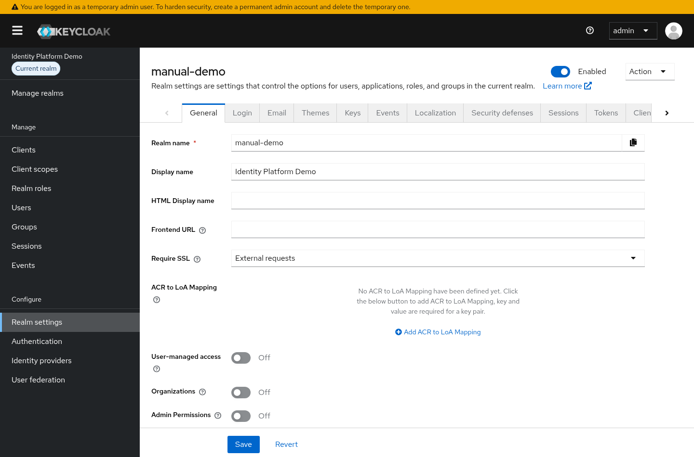
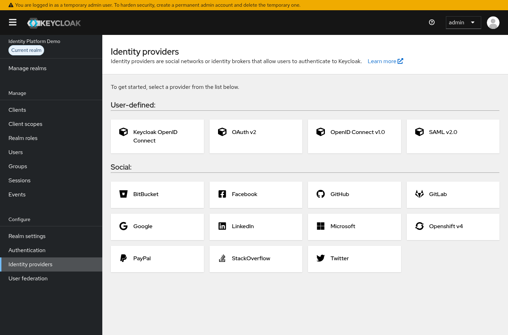
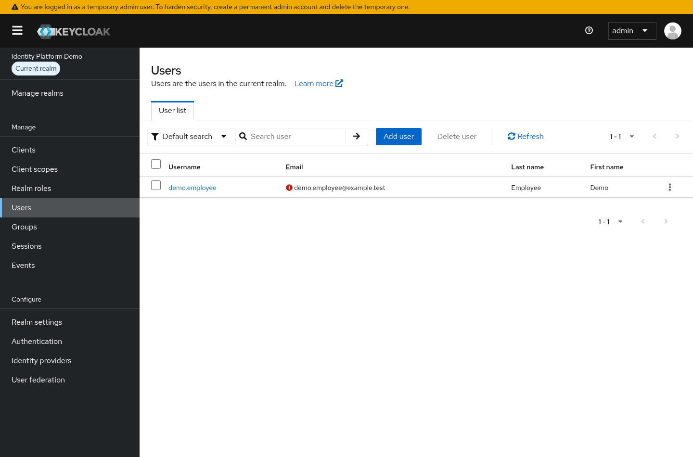
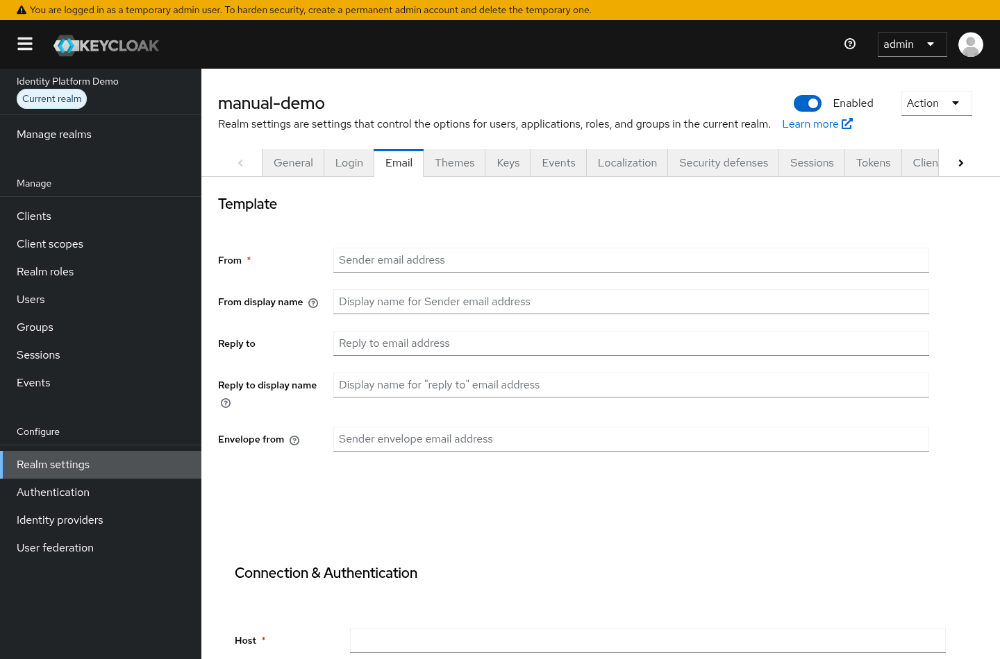
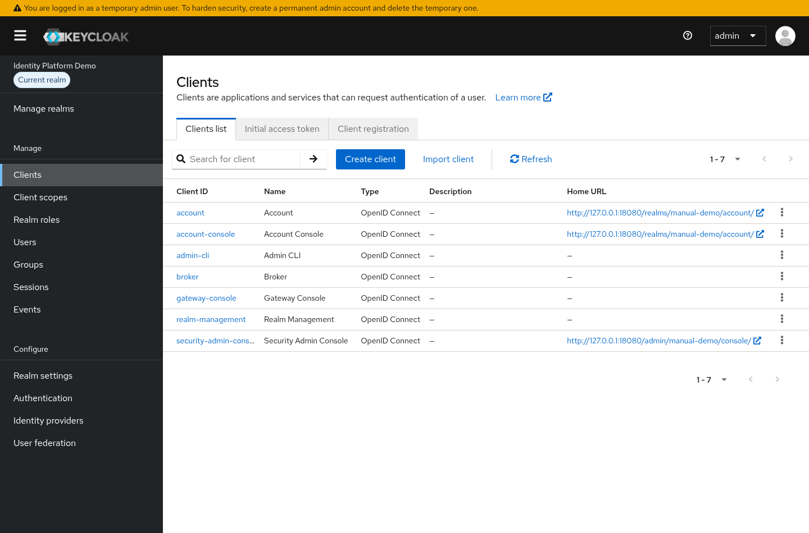
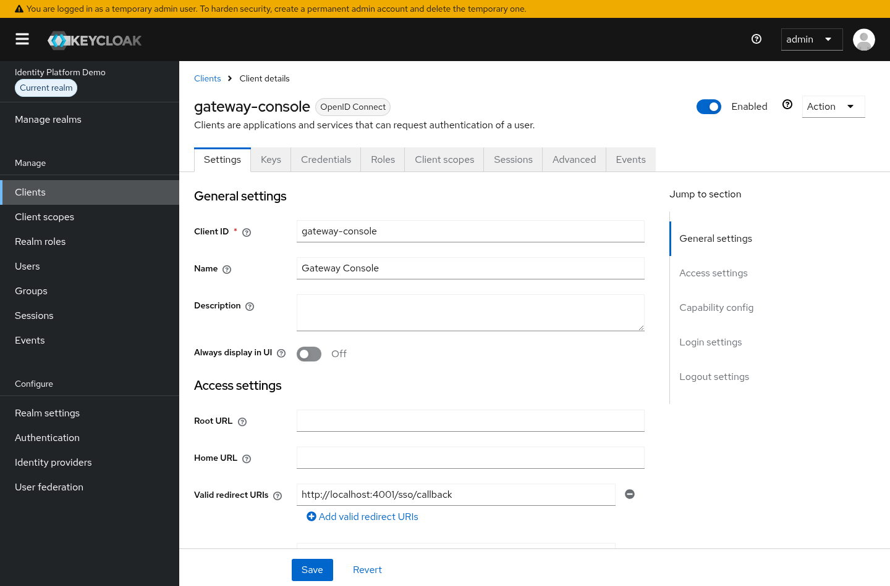
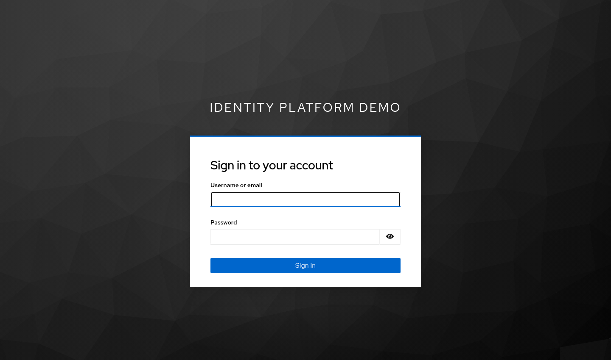
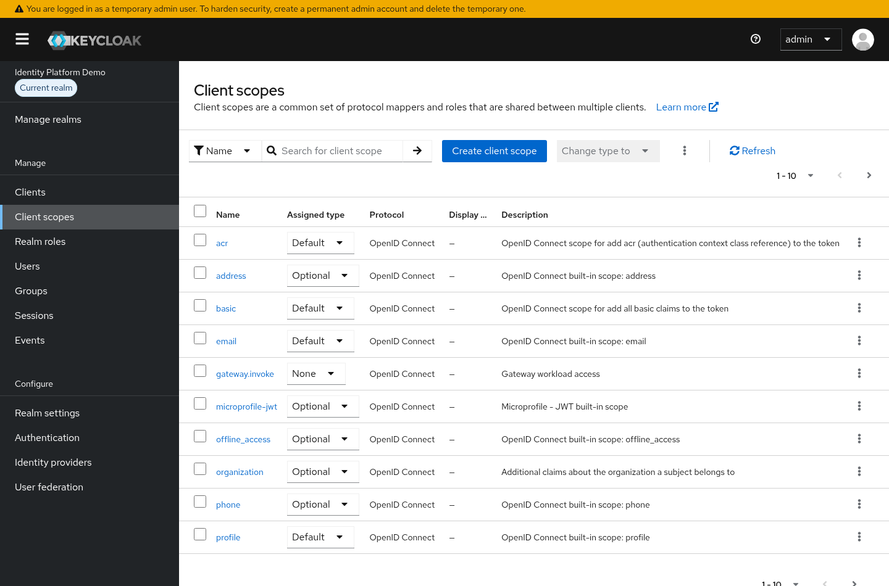

# 统一身份平台使用手册

本手册面向平台管理员、网关管理员和 Agent 运维。截图来自 Keycloak 26.4.7 的隔离演示 realm `manual-demo`，其中的账号为示例。开发部署默认使用 `company`。LiteLLM、Octop 和 AKB 的操作入口用文字标明，截图覆盖身份平台控制台。

## 1. 启动平台并进入业务 realm

在 LiteLLM 仓库执行以下命令，编辑 `.env`，为引导管理员和 PostgreSQL 分别配置独立密码。

```bash
cd identity-platform
cp .env.example .env
```

保存环境配置后启动。

```bash
docker compose up -d
docker compose ps
```

访问 `http://127.0.0.1:18080/admin/`，用引导管理员登录，在左上角选择业务 realm **company**。进入 **Realm settings** 确认 realm 名称。产品配置用 realm issuer `http://127.0.0.1:18080/realms/company`，在其末尾加 `/.well-known/openid-configuration` 可查看端点。生产使用所有使用方都能访问的 HTTPS 地址，并用独立管理客户端替代引导凭证。



## 2. 接入企业登录

1. 在业务 realm 打开 **Identity providers**，添加 OpenID Connect 提供方。
2. 填写企业 IdP 的 discovery URL、给 Keycloak 分配的 Client ID 和客户端密钥。将页面显示的 **Redirect URI** 原样登记到企业 IdP 的客户端。
3. 用测试员工完成一次上游登录。在 **Users** 确认已出现或已关联预期的 realm 用户，再将该 realm 用户 ID 用于产品绑定。已有员工账号应按企业的账号关联流程核对。
4. 配置账号来源时区分企业 OIDC 登录和通讯录同步。企业微信通讯录连接器目前属于规划，当前管理员可通过已配置的企业 IdP、受控导入或 realm 用户管理提供员工身份。



## 3. 查找员工、绑定网关账号和邀请访客

**已有员工。** 在 Keycloak 打开 **Users**，按用户名搜索，进入用户详情并复制 realm 用户 ID。若员工来自企业 OIDC，则先让其按上节完成首次关联。网关管理员在「用户 → 邀请用户 → 关联已有员工」填写该 ID，成功后按审批分配团队和模型权限。服务端需预先配置独立只读目录客户端。也可以通过 `user_onboard.py` 创建绑定。



**访客。** 在 **Realm settings → Email** 配置 SMTP，再配置访客管理服务账号和管理员专用用户属性。网关中选择「用户 → 邀请用户 → 邀请访客」，填写外部邮箱，依次准备账号、核对状态、发送激活邮件。让测试访客打开邮件，完成邮箱验证和密码设置，再进行登录。重复操作前先查状态，邮件已被平台接受不代表已送达。旧邀请入口按网关现有配置继续使用。



[员工绑定、访客属性和 SMTP 前置配置](GATEWAY_INTEGRATION.md#网关预批准员工身份接入)

## 4. 配置产品 SSO 与登录

在 **Clients** 中为每个产品单独配置 OIDC 客户端。打开客户端的 **Settings**，启用标准授权码流程及 S256 PKCE，并将产品实际提供的回调地址登记在 **Valid redirect URIs**。机密客户端在 **Credentials** 获取密钥，由部署系统注入。截图使用示例客户端，具体回调以产品配置为准。





| 产品 | 操作 |
| --- | --- |
| LiteLLM 网关 | 以 `gateway-sso.env.example` 设置 Generic SSO，再配置统一 OIDC issuer 和 JWKS。预先关联一名管理员，验证 SSO 后再启用严格准入。回滚时移除统一 OIDC 设置并按部署方式重启。 |
| Octop 智能工作助手 | 从 Octop 的 OIDC 配置获取回调地址，先绑定管理员并试登录，再设置 `OCTOP_UNIFIED_OIDC_ISSUER` 和 `OCTOP_USER_AUTHENTICATION_MODE=unified_oidc`。恢复旧登录时设为 `legacy` 并重启。 |
| AKB | 给外部委托访问配置独立 audience、issuer、JWKS 和授权客户端，预先关联用户主体。知识库调用同时使用 Agent Service Key 和用户令牌。控制台统一 OIDC 登录尚未交付。 |

用户从产品登录页发起 SSO，浏览器跳转到 Keycloak。配置企业 IdP 后，从 Keycloak 选择对应企业登录入口，认证完成后返回产品。下图为演示 realm 的本地登录页。



[网关 SSO 配置](GATEWAY_INTEGRATION.md#网关预批准员工身份接入) · [Octop 与 AKB 接入](INTEGRATION.md)

## 5. 注册 Agent、领取凭证和下线

在 **Client scopes** 创建 `gateway.invoke`，启用 **Include in token scope**，按工作负载授权。部署独立注册 API，配置专用操作员 OIDC 客户端、Keycloak 管理客户端和网关管理凭证。网关需要信任同一 issuer、配置目标 audience 并允许所需路由。



将短期操作员令牌通过受控环境注入 `AGENTCTL_OPERATOR_TOKEN`。为每次新注册生成 UUID 并保留。以下命令在 `identity-platform` 目录执行。

```bash
platform=https://identity-admin.example.internal
operation_id=$(python -c 'import uuid; print(uuid.uuid4())')
python agentctl.py --platform "$platform" register "$operation_id" --name octop-worker
python agentctl.py --platform "$platform" status "$operation_id"
python agentctl.py --platform "$platform" credential "$operation_id" --secret-file ./octop-credential.json
```

看到 `active` 后，凭证可领取一次。将权限为 `0600` 的文件交给运行时密钥设施。Agent 用文件中的客户端凭证向该 issuer 申请短期访问令牌，再以 `Authorization: Bearer` 访问网关。工作负载注册建立的是调用身份。若要通过网关代理 Agent 的 A2A 服务，还需配置 Agent Card、目标地址和访问控制。

下线时执行：

```bash
python agentctl.py --platform "$platform" disable "$operation_id"
```

若显示 `disabling`，用同一编号重试并查询，直至 `disabled`。注册超时也用原编号查状态和重试。

[注册服务部署与验收](GATEWAY_INTEGRATION.md#通过-agentctl-注册工作负载) · [第三方 Agent 接入指南](../docs/THIRD_PARTY_AGENT_TAKEOVER.md)

## 6. 验收与常见问题

| 现象 | 核对项目 |
| --- | --- |
| SSO 跳转报错 | 检查 issuer、客户端回调 URL、PKCE 和浏览器会话。 |
| 上游认证成功但无法进入产品 | 检查产品是否已关联该 realm 用户 ID，用户是否启用，角色是否已分配。 |
| 访客未收到邮件 | 查询是否仍待激活，再查 Keycloak 和 SMTP 日志。 |
| Agent 能取令牌但网关拒绝 | 检查网关是否信任 issuer、audience 是否匹配、是否包含 `gateway.invoke`、绑定是否启用。 |
| 凭证重复领取返回 409 | 查询 `credential_claimed`。已领取且凭证遗失时，按运维流程停用并重建。 |

真实 Keycloak 已验证授权码登录、员工查找、访客准备和工作负载令牌。Agent 注册流程测试的网关使用 HTTP 替身。正式环境还需实测网关 PostgreSQL 绑定、控制台会话、真实 SMTP 和企业上游 IdP。

[验收命令](README.md#验收命令) · [验证记录](VALIDATION.md)
